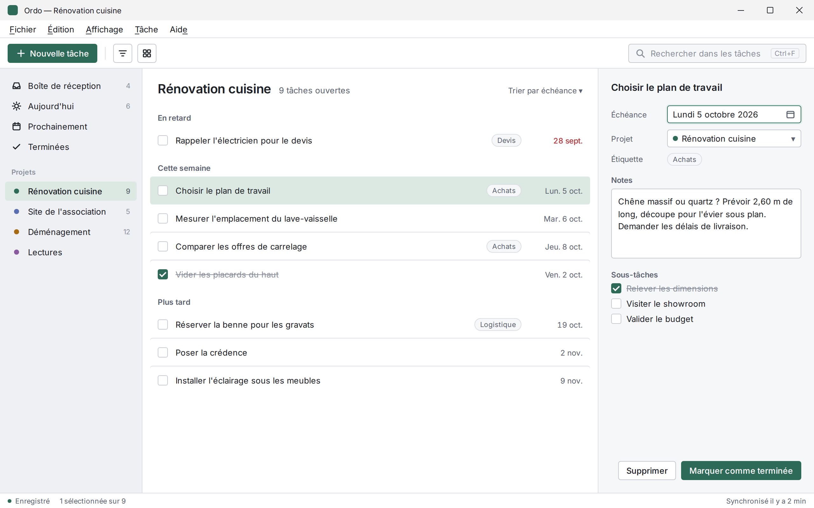
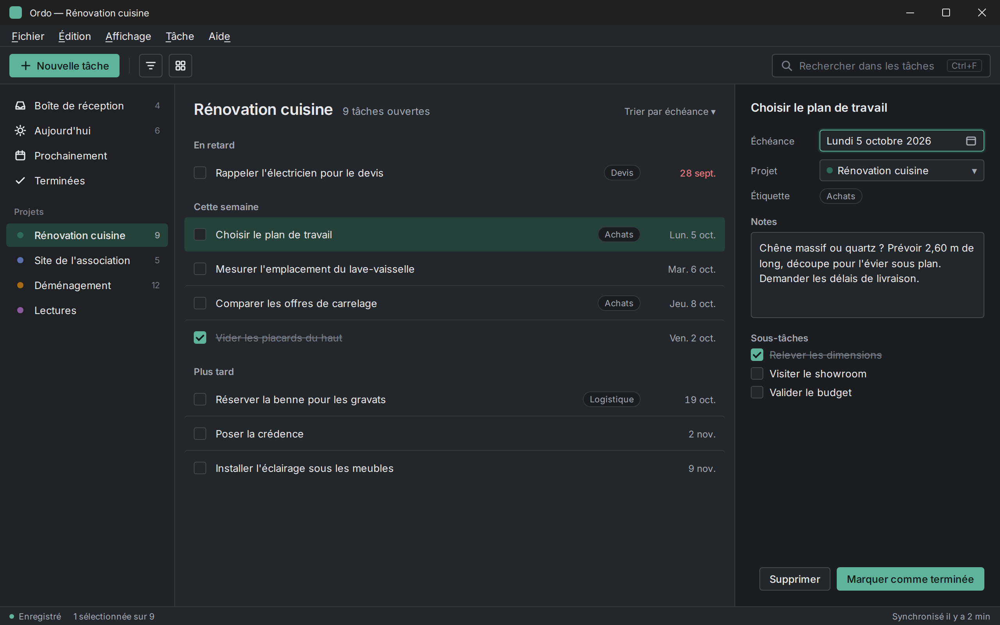

# DESIGN.md

Design guide of the desktop application (Java / JavaFX).
This document is the reference for every visual or interaction decision. When in doubt, the rule is: **behave like a native application of the system, with extra visual care.**



> The screenshots illustrate the system on a sample task management application ("Ordo"). The rules apply whatever the business content. §14 describes how they apply to this project.

---

## 1. Principles

1. **Native first.** Title bar, menus, shortcuts, order of the dialog buttons, font and light/dark theme come from the operating system. We do not redraw them.
2. **Calm.** A single accent colour, used sparingly: primary action, selection, focus. Everything else is neutral. If two elements compete for attention, one of them is wrong.
3. **Content before frame.** Separations are made with space and thin borders, not with stacked shadowed cards. No decorative gradients, no glass effects.
4. **Dense but readable.** It is a working tool: rows of 44 px, text of 13 px, a clear hierarchy. One must see a lot without squinting.
5. **Everything from the keyboard.** Every action reachable with the mouse is reachable with the keyboard too, and the focus is always visible.

---

## 2. Integration with the operating system

| Topic | Rule | JavaFX implementation |
|---|---|---|
| Window | Native decoration, never a custom title bar | `StageStyle.DECORATED` (default) |
| Menu bar | Global menu on macOS, inside the window on Windows/Linux | `menuBar.setUseSystemMenuBar(true)` |
| Shortcuts | Ctrl on Windows/Linux, ⌘ on macOS | Always `KeyCombination.valueOf("Shortcut+N")`, never a hard-coded `Ctrl+` |
| Mnemonics | Underlined letters (`_File`) on Windows/Linux | `mnemonicParsing` enabled on menus and buttons |
| Dialog buttons | Order of each OS (OK at the right on macOS, etc.) | Use `ButtonBar` / `Dialog` with `ButtonData`, never order by hand |
| Theme | Follow the light/dark mode of the system, with a manual option | `Platform.getPreferences().colorSchemeProperty()` (JavaFX 22+) |
| Accent | Accent of the application by default; option "Use the colour of the system" | `Platform.getPreferences().getAccentColor()` |
| Font | System font | `-fx-font-family: "System"` |
| Text size | Respect the scale factor of the OS | Sizes in `em` in the CSS, never fixed pixels on `.root` |
| Preferences | "Preferences…" item in the application menu on macOS, "Options" in Edit/Tools elsewhere | Build the menu according to `System.getProperty("os.name")` |
| Persistence | Size, position, maximized state and width of the panels restored at start-up | `java.util.prefs.Preferences` |

Minimum size of the main window: **960 × 600**. Default size at the first start: **1280 × 800**, centred.

---

## 3. Colours

All the colours are *looked-up colors* defined on `.root`. No hexadecimal code anywhere else in the CSS or in the Java code.

### Light theme

| Token | Value | Use |
|---|---|---|
| `-c-bg` | `#F6F7F9` | Background of the window, detail panel |
| `-c-surface` | `#FFFFFF` | Main content area, fields, toolbars |
| `-c-sidebar` | `#EEF0F3` | Side navigation bar |
| `-c-border` | `#DADDE3` | Separators, light borders |
| `-c-border-strong` | `#C4C9D1` | Borders of fields and buttons |
| `-c-text` | `#1D2128` | Main text |
| `-c-text-2` | `#5B6270` | Secondary text, labels |
| `-c-text-3` | `#8A909C` | Tertiary text, placeholders, counters |
| `-c-accent` | `#2D6A57` | Primary button, checked boxes, focus |
| `-c-accent-subtle` | `#E3EFEA` | Focus halo |
| `-c-selection` | `#DCE9E3` | Selected row or element |
| `-c-on-accent` | `#FFFFFF` | Text on an accent background |
| `-c-danger` | `#B4363A` | Errors, delays, destructive actions |
| `-c-warning` | `#A86A12` | Warnings |

### Dark theme

| Token | Value |
|---|---|
| `-c-bg` | `#1B1D21` |
| `-c-surface` | `#23262B` |
| `-c-sidebar` | `#1F2125` |
| `-c-border` | `#34383F` |
| `-c-border-strong` | `#454A52` |
| `-c-text` | `#E6E8EB` |
| `-c-text-2` | `#A3A9B3` |
| `-c-text-3` | `#757C87` |
| `-c-accent` | `#5FB39A` |
| `-c-accent-subtle` | `#20352F` |
| `-c-selection` | `#24413A` |
| `-c-on-accent` | `#0F1A16` |
| `-c-danger` | `#E0787B` |
| `-c-warning` | `#D9A24F` |



### Rules of use

- The fir green accent was chosen for its calm: it signals without shouting, and it lives well with the blue accents the user may have chosen in the OS.
- Red is used only for what requires an action (delay, error, deletion). Never as a decoration.
- Minimum contrast: 4.5:1 for the text (`-c-text-2` included), 3:1 for the borders of the controls. `-c-text-3` is reserved for non-essential information.
- Colour never carries an information alone: an overdue task has a date in red **and** appears in the "Overdue" section.
- Project colours (dots): `#2D6A57`, `#5A6FB0`, `#A86A12`, `#8A5A9E`, `#4F7F95`, `#9A5B4A`. They only appear as dots of 8 px, never as a background.

---

## 4. Typography

Font: **system font** (Segoe UI Variable on Windows 11, SF Pro on macOS, the interface font of the distribution on Linux). A single family, no embedded font for the interface.

| Role | Size | Weight | Example |
|---|---|---|---|
| View title | 1.54em (≈ 20 px) | Semi-bold | "Kitchen renovation" |
| Panel title | 1.15em (≈ 15 px) | Semi-bold | Title of the task in the detail panel |
| Body | 1em (13 px) | Normal | List rows, fields, buttons |
| Section header | 0.92em (≈ 12 px) | Semi-bold, `-c-text-2` | "This week" |
| Label | 0.92em | Normal, `-c-text-2` | "Due date" |
| Caption | 0.85em (≈ 11 px) | Normal, `-c-text-3` | Counters, status bar |

Rules:

- Sentence case everywhere: "New task", not "New Task" nor "NEW TASK". No labels in capitals.
- Two weights only: normal and semi-bold. Bold serves the hierarchy, not the emphasis.
- Tabular figures for the dates and the numeric columns (alignment).
- Line length of free text areas: 80 characters at most.
- Line spacing of multi-line text areas: 1.5.

---

## 5. Spacing, dimensions, shapes

Base grid of **4 px**. Allowed values: 4, 8, 12, 16, 20, 24, 32.

| Element | Value |
|---|---|
| Height of a button / field (toolbar) | 30 px |
| Height of a field (form) | 28 px |
| Height of a list row | 44 px |
| Height of a navigation item | 30 px |
| Toolbar | 48 px |
| Status bar | 24 px |
| Inner margin of the panels | 20 px |
| Left margin of the list content | 24 px |
| Width of the side bar | 224 px (resizable, 180–320) |
| Width of the detail panel | 340 px (resizable, 280–480, collapsible) |

Radii:

| Element | Radius |
|---|---|
| Buttons, fields, selected rows, navigation items | 4 px |
| Check boxes | 3 px |
| Context menus, popovers, tooltips | 6 px |
| Dialogs (if not native) | 8 px |
| Tags | fully rounded |

Shadows: only for what floats above the content (menus, popovers, drop-down lists). A single shadow:
`dropshadow(gaussian, rgba(0,0,0,0.16), 12, 0, 0, 4)`. No shadow on the elements laid in the window.

---

## 6. Structure of the window

```
┌──────────────────────────────────────────────────────────────┐
│ Native title bar                                             │
├──────────────────────────────────────────────────────────────┤
│ Menus (Windows/Linux only)                                   │
├──────────────────────────────────────────────────────────────┤
│ [+ Primary action] │ [tools]              [Search    Ctrl+F] │
├────────────┬──────────────────────────────┬──────────────────┤
│ Navigation │ View title        counter    │ Detail of the    │
│            │ Section                      │ selected         │
│ Views      │ ☐ Element ............ date   │ element          │
│            │ ☐ Element ............ date   │                  │
│ Groups     │                              │                  │
│            │                              │  [Sec.] [Prim.]  │
├────────────┴──────────────────────────────┴──────────────────┤
│ Save state · selection                        synchronisation│
└──────────────────────────────────────────────────────────────┘
```

- Three-panel layout through `SplitPane`, positions of the dividers remembered.
- The content is aligned to the left. Only the dates and the numbers are aligned to the right.
- The detail panel collapses automatically below 1100 px of width, and then opens as an overlay.
- The toolbar holds **one** primary action (filled accent button), at the left. The other tools are icon buttons with a tooltip.
- The search is at the right of the toolbar, with its shortcut shown.

---

## 7. Components

### Buttons

| Variant | Appearance | Use |
|---|---|---|
| Primary | Background `-c-accent`, text `-c-on-accent` | Once per zone (toolbar, panel, dialog) |
| Secondary | Background `-c-surface`, border `-c-border-strong` | Common actions |
| Icon | Secondary, square of 30 × 30, icon of 16 px | Tools of the toolbar, always with a tooltip |
| Destructive | Secondary, text `-c-danger` on hover and in the confirmation dialogs | Delete |

The label says exactly what happens: "Mark as done", not "OK"; "Delete the task", not "Confirm".

### Fields

- Border `-c-border-strong`, background `-c-surface`, radius 4 px.
- Focus: border `-c-accent` + halo of 2 px `-c-accent-subtle`. This focus style is the same for every control.
- Error: border `-c-danger` and a message under the field ("The date must be after today"), never only a colour.
- Placeholder in `-c-text-3`, never used instead of a label.

### Lists

- Rows of 44 px, separated by a hairline `-c-border`, without stripes.
- Hover: background `-c-bg`. Selection: background `-c-selection`, radius 4 px, hairlines around hidden.
- Multiple selection: Shift and Shortcut, as in the file explorer.
- A done element turns `-c-text-3` struck through, and moves down into its section after 2 s (to leave time to undo).
- The sections ("Overdue", "This week") are simple text headers, not cards.

### Side navigation

- Items of 30 px, icon of 16 px at the left, counter as a caption at the right.
- Active item: background `-c-selection`, semi-bold text.
- The groups ("Projects") have a semi-bold caption header, `-c-text-3`.

### Tags

Background `-c-bg`, border `-c-border`, caption text `-c-text-2`. Neutral: colour is reserved for the project dots.

### Dialogs

- Always a JavaFX `Dialog` / `Alert` with a `ButtonBar`, for the native order of the buttons.
- Modal only if a decision is required. Otherwise, prefer an action that can be undone.
- Title = the question or the action ("Delete “Fit the splashback”?"), text = the consequence ("The task and its 3 subtasks will be deleted.").

### Status feedback

- Status bar at the bottom: save state, number of selected elements, synchronisation.
- After a destructive or bulk action: a discreet notification at the bottom of the list with an "Undo" button, visible for 6 s.
- Empty states: a sentence that says what to do ("No task in this project. Press Ctrl+N to create one.") and the matching button. No illustration.
- Errors: say what happened and how to correct it ("Cannot save: the disk is full. Free some space then try again."). No apologies, no vague message.

---

## 8. Icons

- Line style, stroke of 1.6 px at 16 px, round ends, a single icon family in the whole application (Ikonli with a consistent line pack, or home-made `SVGPath`).
- Size: 16 px in the interface, 20 px at most in the empty states.
- Colour: `-c-text` by default, `-c-accent` for the active element only.
- Icons are never alone without a label or a tooltip.
- Bitmap images: provide the `@2x` variants (JavaFX loads them automatically on HiDPI screens).

---

## 9. Motion

Animations answer an action of the user, they do not decorate.

| Situation | Animation | Duration |
|---|---|---|
| Opening/closing of the detail panel | Horizontal slide | 180 ms |
| Change of selection | None (immediate) | — |
| Done element changing section | Fade + move | 200 ms, after 2 s |
| Appearance of a notification | Fade | 120 ms |
| Hover | No transition | — |

Curve: `Interpolator.SPLINE(0.2, 0, 0, 1)`. A "Reduce animations" option in the preferences replaces every animation by an immediate change.

---

## 10. Keyboard and accessibility

Minimum shortcuts (written here for Windows/Linux, Ctrl becomes ⌘ on macOS):

| Action | Shortcut |
|---|---|
| New element | Ctrl+N |
| Search | Ctrl+F |
| Open the detail / edit | Enter |
| Mark as done | Ctrl+Enter |
| Delete | Del (⌫ on macOS) |
| Undo / Redo | Ctrl+Z / Ctrl+Shift+Z (and Ctrl+Y on Windows) |
| Toggle the side bar | Ctrl+B |
| Preferences | Ctrl+, |
| Move from a panel to another | F6 / Shift+F6 |

Accessibility:

- Logical tab order: toolbar → navigation → list → detail.
- Focus always visible, in the lists too (ring `-c-accent` on the cell).
- `setAccessibleText()` on every icon button and colour dot.
- Minimum clickable area of 24 × 24 px, even when the icon is 16 px.
- Test with Narrator (Windows) and VoiceOver (macOS), and with a system zoom of 150 %.

---

## 11. Writing

- Vocabulary of the user, not of the code: "Projects", not "Collections"; "Due date", not "dueDate".
- An action keeps the same name everywhere: the button "Mark as done" produces the notification "Task done".
- Verbs on the buttons, short sentences, sentence case.
- Relative dates when clearer ("Today", "Mon. 5 Oct."), absolute in the detail panel. Format according to the `Locale` of the system.

---

## 12. JavaFX implementation

### Organisation of the style sheets

```
src/main/resources/css/
  tokens-light.css    # colour tokens of the light theme
  tokens-dark.css     # tokens of the dark theme
  base.css            # typography, spacing, controls
  components.css      # navigation, lists, detail, status bar
```

We start from Modena (the default theme of JavaFX) and override it through its own variables, to keep the native behaviour of the controls.

### Tokens and connection to Modena

```css
/* tokens-light.css */
.root {
    -c-bg: #F6F7F9;
    -c-surface: #FFFFFF;
    -c-sidebar: #EEF0F3;
    -c-border: #DADDE3;
    -c-border-strong: #C4C9D1;
    -c-text: #1D2128;
    -c-text-2: #5B6270;
    -c-text-3: #8A909C;
    -c-accent: #2D6A57;
    -c-accent-subtle: #E3EFEA;
    -c-selection: #DCE9E3;
    -c-on-accent: #FFFFFF;
    -c-danger: #B4363A;
    -c-warning: #A86A12;
}
```

```css
/* base.css */
.root {
    -fx-font-family: "System";
    -fx-font-size: 1em;

    /* Connection of the tokens to Modena */
    -fx-base: -c-surface;
    -fx-background: -c-bg;
    -fx-control-inner-background: -c-surface;
    -fx-accent: -c-accent;
    -fx-default-button: -c-accent;
    -fx-focus-color: -c-accent;
    -fx-faint-focus-color: -c-accent-subtle;
    -fx-selection-bar: -c-selection;
    -fx-selection-bar-non-focused: -c-selection;
    -fx-text-base-color: -c-text;
    -fx-text-background-color: -c-text;
    -fx-prompt-text-fill: -c-text-3;
}

.button {
    -fx-background-color: -c-border-strong, -c-surface;
    -fx-background-insets: 0, 1;
    -fx-background-radius: 4, 3;
    -fx-padding: 0 12 0 12;
    -fx-pref-height: 30;
    -fx-font-weight: 500;
}

.button:default {
    -fx-background-color: -c-accent;
    -fx-background-insets: 0;
    -fx-text-fill: -c-on-accent;
}

.text-field, .combo-box, .date-picker .text-field {
    -fx-background-color: -c-border-strong, -c-surface;
    -fx-background-insets: 0, 1;
    -fx-background-radius: 4, 3;
}

.text-field:focused {
    -fx-background-color: -c-accent-subtle, -c-accent, -c-surface;
    -fx-background-insets: -2, 0, 1;
    -fx-background-radius: 6, 4, 3;
}

.title-view   { -fx-font-size: 1.54em; -fx-font-weight: 600; }
.title-panel  { -fx-font-size: 1.15em; -fx-font-weight: 600; }
.section-head { -fx-font-size: 0.92em; -fx-font-weight: 600; -fx-text-fill: -c-text-2; }
.caption      { -fx-font-size: 0.85em; -fx-text-fill: -c-text-3; }
```

### Following the theme of the system

```java
public final class ThemeManager {

    public enum Mode { SYSTEM, LIGHT, DARK }

    private final Scene scene;
    private Mode mode = Mode.SYSTEM;

    public ThemeManager(Scene scene) {
        this.scene = scene;
        Platform.getPreferences().colorSchemeProperty()
                .addListener((obs, old, scheme) -> apply());
        apply();
    }

    public void setMode(Mode mode) {
        this.mode = mode;
        apply();
    }

    private void apply() {
        boolean dark = switch (mode) {
            case LIGHT -> false;
            case DARK -> true;
            case SYSTEM -> Platform.getPreferences().getColorScheme() == ColorScheme.DARK;
        };
        scene.getStylesheets().setAll(
                css(dark ? "tokens-dark.css" : "tokens-light.css"),
                css("base.css"),
                css("components.css"));
    }

    private static String css(String name) {
        return ThemeManager.class.getResource("/css/" + name).toExternalForm();
    }
}
```

### Native behaviours not to forget

```java
// Global menu on macOS
menuBar.setUseSystemMenuBar(true);

// Cross-platform shortcuts
newItem.setAccelerator(KeyCombination.valueOf("Shortcut+N"));

// Native order of the dialog buttons
Alert alert = new Alert(Alert.AlertType.CONFIRMATION);
alert.getButtonTypes().setAll(
        new ButtonType("Delete the task", ButtonBar.ButtonData.OK_DONE),
        new ButtonType("Cancel", ButtonBar.ButtonData.CANCEL_CLOSE));

// Minimum size and restoration of the window
stage.setMinWidth(960);
stage.setMinHeight(600);
```

---

## 13. Review checklist

Before merging a screen:

- [ ] No hard-coded colour outside the `tokens-*.css` files.
- [ ] Tested in light, in dark, and with the accent of the system enabled.
- [ ] Tested on Windows and macOS (at least), at 100 % and 150 % scale.
- [ ] A single primary action per zone.
- [ ] Everything reachable from the keyboard, focus visible everywhere.
- [ ] The shortcuts use `Shortcut`, the dialogs use `ButtonBar`.
- [ ] Empty, loading and error states written and shown.
- [ ] Labels in sentence case, vocabulary of the user.

---

## 14. Application to this project

The rules above apply to the Jass Tournament as follows (decisions of the maintainer of 2026-10-04, and constraints of the project):

| Topic | In this project |
|---|---|
| Style sheets | `src/main/resources/ch/varani/jass/app/` (`tokens-light.css`, `tokens-dark.css`, `base.css`, `components.css`), in the package of the application so that the named module finds them; applied by `Theme`. The tokens are defined on `.root` **and** `.dialog-pane`, so that the message boxes get them. Two tokens are added: `-c-red-suit` (the suits ♥ ♦) and `-c-shadow` (the colour of the single shadow). |
| Navigation | Side bar: Editions, Directory, Trash with their counts; while an edition is open, its name and its parts (Registration, Schedule, Scores, Ranking, Display, Accounting). No tabs. |
| External display | A second window (`DisplayWindow`) for a projector: the same tokens and theme, large texts (lines of 56 px, countdown of about 80 px), no toolbar nor control (everything is controlled from the main window), no full screen hint over the content; the time over is said in words and in `-c-danger`. |
| Detail panel | The entry of the players (registration), the score sheet of a game (scores), the entry of the accounting with its supporting documents and the form of a person (directory), floating below 1100 px (`DetailLayout`). |
| Score sheet | A grid as the paper sheet: column A typed, column B derived in `-c-text-3` until typed; the inconsistent deals have a border in `-c-warning` **and** are listed under the sheet (colour never alone). A value is taken on Enter or when the field is left; Up and Down move in a column. Once the lots are drawn, the sheet is disabled and a notice in `-c-warning` says how to correct it (cancel the draw from the ranking). |
| Preferences | Panel of settings: theme (system, light, dark), accent of the system, reduced animations, logo of the documents. JavaFX cannot add an item to the application menu of macOS: "Settings…" (Shortcut+,) is in the File menu on macOS, "Options…" in the Tools menu elsewhere; on macOS, the application menu quits. |
| About | Panel from the Help menu on every system (JavaFX cannot add an item to the application menu of macOS): icon, name and version, author and licence, links in `-c-accent` (`Hyperlink`, reachable with Tab) to the site of the author and to the source code, opened in the browser only when clicked; the donation is the default button (accent), Close the other one, Escape closes. |
| Persistence | The settings and the state of the window (size, position, maximized, dividers) are saved in the data folder (`settings.properties`, `SettingsStore`) instead of `java.util.prefs`, so that the tests never touch the preferences of the user and the settings travel with the backup. |
| Confirmations | The destructive actions are confirmed by a message box (question, consequence, action named; the action is not the default button and is red), not undone through a notification. The information that needs no decision is a notice of the status bar, for 6 s. |
| Icons | Home-made line icons (`Icon`, `SVGPath`), no Ikonli dependency. |
| Shortcuts | Shortcut+N new element of the view, Shortcut+S save of the form of the view (registration, accounting, directory), Shortcut+F search, Shortcut+O import, Shortcut+E export, Shortcut+1/2/3 editions/directory/trash, Shortcut+B side bar, Shortcut+, settings, Enter opens and Delete deletes in the tables, F6 / Shift+F6 between the panels. |
| Not applied yet | Mnemonics of the buttons (the menus have them); tabular figures (not available in the CSS of JavaFX); undo/redo; the "done element" and "tags" components (no such element in the application). |
