

# Jassturnier — Benutzerhandbuch

[English](en.md) · [Français](fr.md) · Deutsch · [Italiano](it.md)

Das **Jassturnier** begleitet ein _Schieber_-Turnier (_Chibre_) von Anfang bis Ende: Anmeldungen, Spielplan (wer in
jeder Partie gegen wen spielt und welches Team zuerst gibt), Dokumente zum Drucken, Erfassen der Punkte, Rangliste,
Anzeige im Saal und Buchhaltung. Es folgt dem Reglement des _match aux cartes des vétérans du FC Bevaix_ und
funktioniert ohne Internetverbindung.

Dieses Handbuch folgt dem Ablauf eines Turniers: vorbereiten, anmelden, drucken, spielen, rangieren, abrechnen.
Die Bildschirmfotos zeigen ein erfundenes Turnier in der Darstellung von Windows und Linux; unter macOS sind die Menüs in der Menüleiste des Systems.

## Inhalt

1. [Die Anwendung installieren](#1-die-anwendung-installieren)
2. [Das Fenster kennenlernen](#2-das-fenster-kennenlernen)
3. [Das Logo der Dokumente wählen](#3-das-logo-der-dokumente-wählen)
4. [Das Verzeichnis führen](#4-das-verzeichnis-führen)
5. [Eine Ausgabe erstellen](#5-eine-ausgabe-erstellen)
6. [Die Teilnehmenden anmelden](#6-die-teilnehmenden-anmelden)
7. [Den Spielplan berechnen und die Dokumente drucken](#7-den-spielplan-berechnen-und-die-dokumente-drucken)
8. [Am Turniertag: die Anzeige im Saal](#8-am-turniertag-die-anzeige-im-saal)
9. [Die Punkte erfassen](#9-die-punkte-erfassen)
10. [Die Rangliste erstellen](#10-die-rangliste-erstellen)
11. [Die Buchhaltung führen](#11-die-buchhaltung-führen)
12. [Sichern, exportieren, eine Ausgabe wiederfinden](#12-sichern-exportieren-eine-ausgabe-wiederfinden)
13. [Tastenkürzel](#13-tastenkürzel)
14. [Häufige Meldungen](#14-häufige-meldungen)
15. [Personendaten](#15-personendaten)

## 1. Die Anwendung installieren

Laden Sie das Installationsprogramm Ihres Systems von der Seite der
[veröffentlichten Versionen](https://github.com/porchy13/jass-tournament/releases) herunter:

| System | Datei | Installation |
|--------|-------|--------------|
| macOS (Apple Silicon oder Intel) | `.dmg` | Öffnen Sie die Datei und ziehen Sie **Jass Tournament** in den Ordner Programme. |
| Windows | `.msi` | Öffnen Sie die Datei und folgen Sie den Schritten. |
| Linux (Debian, Ubuntu) | `.deb` | `sudo apt install ./<datei>.deb` |

Die Anwendung ist noch nicht signiert:

- **macOS** verweigert beim ersten Mal das Öffnen. Klicken Sie mit der rechten Maustaste auf die Anwendung und
  wählen Sie **Öffnen**; bei neueren macOS-Versionen öffnen Sie **Systemeinstellungen › Datenschutz & Sicherheit**
  und wählen **Dennoch öffnen**.
- **Windows** zeigt eine SmartScreen-Warnung: Wählen Sie **Weitere Informationen** und dann **Trotzdem ausführen**.

Die Anwendung spricht die Sprache des Systems: Französisch, Deutsch, Italienisch oder Englisch für jede andere
Sprache.

### Die Anwendung aktualisieren

Bei jedem Start prüft die Anwendung, ob eine neuere Version veröffentlicht ist. Wenn ja, bietet sie diese mit ihren
Neuerungen an: **Herunterladen und installieren** lädt das Installationsprogramm herunter (der Fortschritt wird
angezeigt, **Abbrechen** unterbricht ihn), dann speichert die Anwendung alles, öffnet das Installationsprogramm und
beendet sich; folgen Sie den Schritten der Installation wie oben. **Später** verschiebt die Aktualisierung auf den
nächsten Start. Ohne Internet startet die Anwendung normal und zeigt nichts an.

**Hilfe › Nach Updates suchen…** startet die Prüfung jederzeit: Die Anwendung bietet die neue Version an, oder meldet,
dass sie bereits die neueste ist oder dass die Prüfung fehlgeschlagen ist (zum Beispiel ohne Internet).

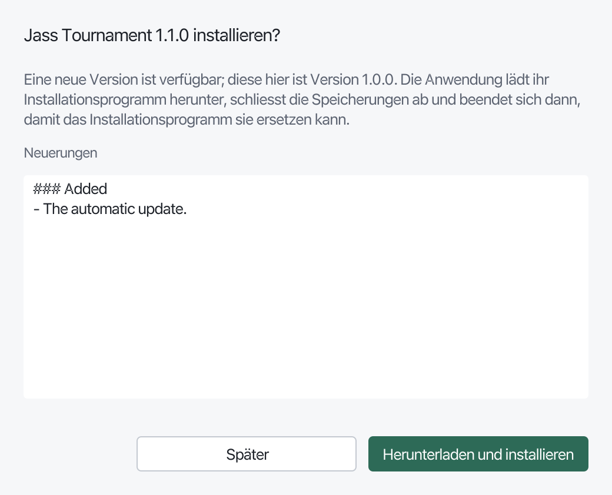

## 2. Das Fenster kennenlernen

- **Die Menüs** (oben; unter macOS in der Menüleiste des Systems): **Datei**, **Ansicht**, **Extras** (ausser unter
  macOS) und **Hilfe**.
- **Die Seitennavigation** (links): **Ausgaben**, **Verzeichnis** und **Papierkorb**. Ist eine Ausgabe geöffnet,
  erscheint ihr Name mit ihren Teilen: **Anmeldungen**, **Spielplan**, **Punkte**, **Rangliste**, **Anzeige** und
  **Buchhaltung**. Sie werden im Lauf des Turniers in dieser Reihenfolge benutzt.
- **Die Liste** (in der Mitte): der Inhalt des gewählten Teils.
- **Das Detailfeld** (rechts): das in der Liste gewählte Element, bereit zum Ändern. In einem schmalen Fenster
  schwebt es über der Liste.
- **Die Statusleiste** (unten): zeigt, ob alles **Gespeichert** ist, was ausgewählt ist, und die Hinweise.

**Von Hand ist nichts zu speichern**: Jede Änderung wird sofort gespeichert. Aktionen, die etwas löschen, verlangen
immer eine Bestätigung.

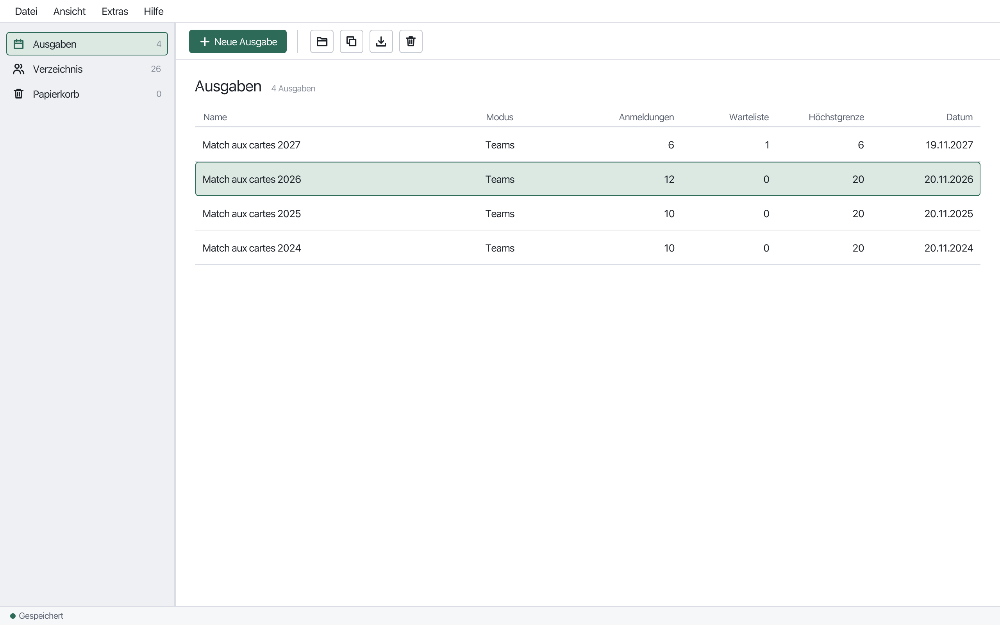

**Hilfe › Über** zeigt die Version der Anwendung, ihren Autor, ihre Lizenz und den Link zu ihrem Quellcode;
**Spenden** öffnet die Seite der Spenden im Browser.

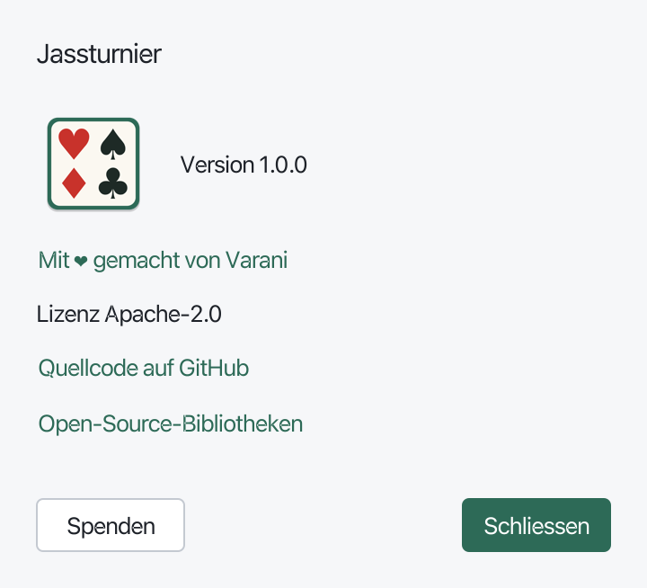

## 3. Das Logo der Dokumente wählen

Das Logo Ihres Vereins oder Ihres Turniers wird **oben links auf jedes Dokument** gedruckt (Spielplan, Plätze zum
Aushängen, Punktekarten, Resultatblätter) und auf **der Anzeige im Saal** gezeigt. Wählen Sie es, bevor Sie die
Dokumente drucken:

1. Öffnen Sie **Einstellungen…** (Menü **Datei** unter macOS) oder **Optionen…** (Menü **Extras** unter Windows und
   Linux).
2. Wählen Sie unter **Logo der Dokumente** die Schaltfläche **Bild wählen…** und das Bild.
3. Das Logo wird im Feld gezeigt; die Statusleiste bestätigt, dass es auf die Dokumente gedruckt wird.

Das Bild muss eine **PNG- oder JPEG-Datei von höchstens 2 MB** sein. Ein PNG-Bild **mit transparentem Hintergrund**
eignet sich am besten, weil es sich in jedes Dokument einfügt; ein genügend grosses Bild bleibt im Druck scharf.

Das Logo gilt für **alle Ausgaben**: Es wird im Datenordner der Anwendung aufbewahrt, nicht in den Ausgaben. Eine
auf einen anderen Computer exportierte Ausgabe nimmt es also nicht mit: Wählen Sie es auch auf jenem Computer.
**Alles sichern…** schliesst es in die Sicherung ein.

**Logo entfernen** (nach einer Bestätigung) druckt die Dokumente ohne Logo.

Dieselben Einstellungen betreffen auch das Aussehen der Anwendung: **Design** (wie das System, hell oder dunkel),
**Akzentfarbe des Systems verwenden** und **Animationen reduzieren**.

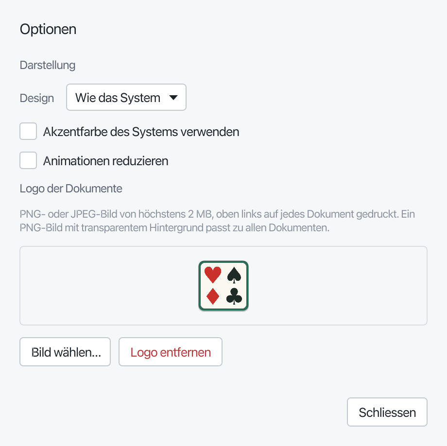

## 4. Das Verzeichnis führen

Das **Verzeichnis** bewahrt die Personen von einer Ausgabe zur nächsten auf: Sie werden bei der Anmeldung
vorgeschlagen und können für das nächste Turnier wieder kontaktiert werden.

- **Neue Person** (Hauptschaltfläche): Vorname (Pflicht), Name, E-Mail, Telefon, Bemerkungen, Status, dann
  **Speichern**. Mehrere Personen lassen sich nacheinander allein mit der Tastatur erfassen. Gibt es bereits eine
  ähnliche Person, meldet die Anwendung dies, bevor ein Duplikat entsteht.
- Einen Namen **suchen**; die Personen einer Ausgabe filtern.
- **Status**: _Kontaktierbar_, _Nicht kontaktieren_ (auf Wunsch der Person) oder _Verstorben_. Die beiden letzten
  halten die Person aus den Kontaktlisten fern; eine verstorbene Person wird bei der Anmeldung nicht mehr
  vorgeschlagen.
- **E-Mail-Adressen kopieren** oder **Telefonnummern kopieren** der ausgewählten Personen, um sie in eine Nachricht
  einzufügen (ohne die Personen, die nicht kontaktiert werden wollen).
- **Die zwei ausgewählten Personen zusammenführen** vereint zwei Einträge derselben Person.
- **Kontaktdaten löschen** oder **Person löschen** löscht sie endgültig.
- **Personen importieren…** aus einer CSV-Datei oder aus Zeilen, die aus einer Tabelle kopiert wurden: Wählen Sie die
  Spalten, prüfen Sie die Vorschau (ungültige Werte und mögliche Duplikate werden gemeldet) und wählen Sie
  **Importieren**. Duplikate werden nur importiert, wenn **Mögliche Duplikate auch importieren** angekreuzt ist.
- **Verzeichnis exportieren…** als CSV, zum Beispiel um einer Person zu antworten, die ihre gespeicherten Daten
  verlangt.

Das Verzeichnis beginnt leer; es kann auch im Lauf der Anmeldungen gefüllt werden.

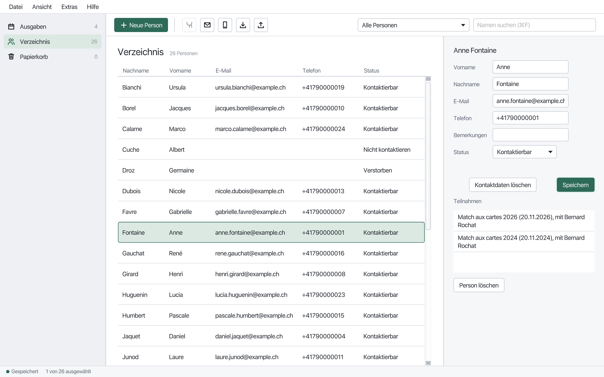

## 5. Eine Ausgabe erstellen

Wählen Sie unter **Ausgaben** die Schaltfläche **Neue Ausgabe**:

- **Name** und **Datum**;
- **Modus**: _Teams_ (die Zweierteams melden sich gemeinsam an) oder _Einzeln_ (jede Person meldet sich allein an;
  die Anwendung bildet die Teams mit einem anderen Partner in jeder Partie und begrenzt, wie oft sich zwei Spielende
  als Gegner treffen);
- **Partien pro Teilnehmende**: 4 gemäss Reglement; die Zahl muss gerade sein, weil jedes Team in der Hälfte seiner
  Partien zuerst gibt;
- **Höchstzahl der Teams**: 20 als Vorgabe (doppelt so viele Spielende im Einzelmodus); darüber hinaus kommen die
  Anmeldungen auf die Warteliste;
- **Inhalt der Partien**: die Art jedes Spiels (vorgegebener Trumpf ♥ ♣ ♦ ♠, _Schieber_, _Kreuz_, gezwungener
  Trumpf). **Plan des Reglements** stellt die 16 Spiele des Reglements wieder her; **4 Spiele hinzufügen** und
  **4 Spiele entfernen** ändern ihre Anzahl, immer ein Vielfaches von 4.

**Erstellen** bleibt gesperrt, solange ein Wert fehlt; der Grund wird angezeigt.

Für das nächste Jahr wählen Sie die vorherige Ausgabe und **Ausgabe duplizieren**: Die neue übernimmt Modus, Partien,
Höchstzahl der Teams, Inhalt der Partien und Startgeld, aber nicht die Anmeldungen.

Die Liste der Ausgaben zeigt für jede die Zahl der **Anmeldungen**, die Zahl der Anmeldungen auf der **Warteliste**
und die Höchstzahl der Teams (**Höchstgrenze**). Öffnen Sie eine Ausgabe mit einem Doppelklick oder der Eingabetaste.

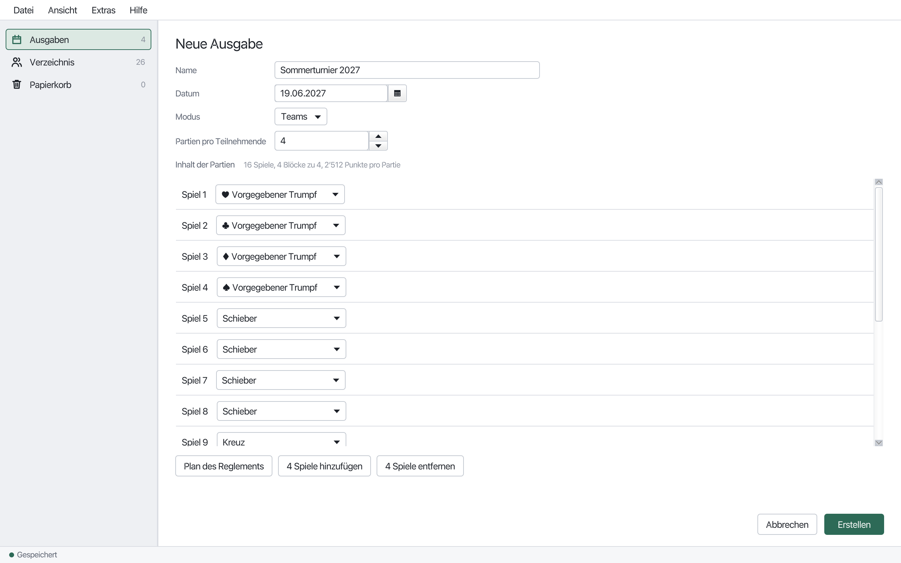

## 6. Die Teilnehmenden anmelden

Unter **Anmeldungen** nimmt das rechte Feld die Spielenden auf (zwei pro Team, eine Person im Einzelmodus):

1. Tippen Sie den Vor- oder Nachnamen: Bis zu 8 Personen des Verzeichnisses werden vorgeschlagen, ausser den
   bereits für die Ausgabe angemeldeten; wählen Sie eine
   oder tippen Sie weiter für eine neue Person, die ins Verzeichnis aufgenommen wird.
2. Hat die Person schon gespielt, schlägt die Anwendung vor, das **vorherige Team erneut anzumelden**.
3. **Anmelden** (Cmd+S unter macOS, sonst Ctrl+S) fügt die Anmeldung hinzu; **Neue Anmeldung** leert das Feld.

Wählen Sie eine Anmeldung, um sie zu **Korrigieren** oder zu **Entfernen**. Wurden die Namen einer Person seither im
Verzeichnis korrigiert, ist die Anmeldung mit _Namen im Verzeichnis korrigiert_ markiert: **Korrigieren** übernimmt
die neuen Namen.

Eine im Verzeichnis als verstorben vermerkte Person kann nicht angemeldet werden. Tippen Sie ihren Vor- und Nachnamen,
fragt die Anwendung, ob es sich um eine andere Person mit denselben Namen handelt: **Andere Person** nimmt sie ins
Verzeichnis auf und meldet sie an, sonst wird nichts angemeldet. Eine Anmeldung, deren Person seither als verstorben
vermerkt wurde, ist mit _Verstorbene Person im Verzeichnis_ markiert: Um sie zu korrigieren, ersetzen Sie diese
Person (sie kann jederzeit entfernt werden).

Die Zahl der Anmeldungen wird angezeigt, mit der Höchstzahl und dem nötigen Minimum für den Spielplan (zum Beispiel
5 Teams für 4 Partien).

Der Spielplan wird aus den Teams berechnet, die beim Schliessen der Anmeldung angemeldet sind: siehe
[Den Spielplan berechnen](#7-den-spielplan-berechnen-und-die-dokumente-drucken).

### Warteliste

Die **Höchstzahl der Teams** wird oberhalb der Liste geändert, solange die Anmeldung offen ist. Ist die Ausgabe voll,
zeigt das Feld es an, und **Anmelden** setzt die Anmeldung auf die Warteliste: Die folgenden Anmeldungen warten unter
der Liste der Angemeldeten, in der Reihenfolge ihres Eingangs (wer zuerst kommt, kommt zuerst dran). Wählen Sie eine
wartende Anmeldung, um sie zu **Korrigieren** oder von der Liste zu **Entfernen**.

Wird eine angemeldete Person entfernt, nimmt die erste wartende Anmeldung ihren Platz ein. Eine höhere Höchstzahl
meldet die ersten Wartenden an; eine tiefere setzt die zuletzt Angemeldeten an die Spitze der Warteliste.

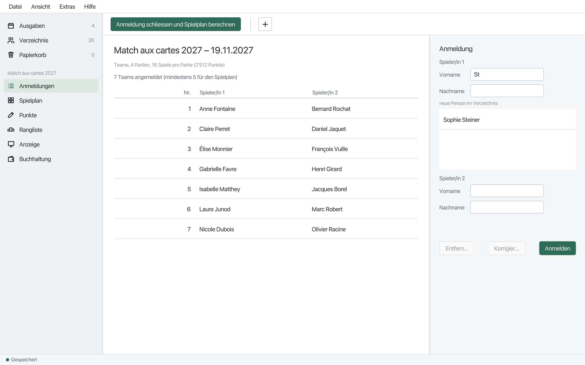

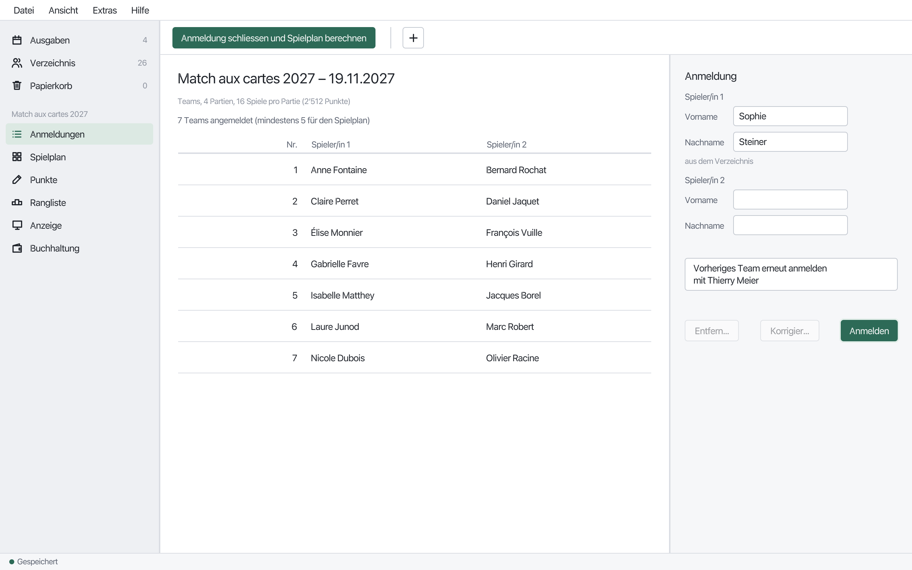

## 7. Den Spielplan berechnen und die Dokumente drucken

### Der Spielplan geht von den Anmeldungen aus

Die Anwendung füllt keinen im Voraus vorbereiteten Spielplan für eine feste Anzahl Teams aus: Sie berechnet den
Spielplan aus den **angemeldeten Teams** beim Schliessen der Anmeldung, jedes mit seiner Nummer (Spalte **Nr.**, in der
Reihenfolge der Anmeldungen). Sie stellt einen Tisch für zwei Teams auf: 12 angemeldete Teams spielen an 6 Tischen,
auf den Plätzen 1 bis 12. Im Einzelmodus bildet sie die Teams aus den angemeldeten Spielern, ein Tisch für vier
Spieler. Die Anmeldungen auf der Warteliste erhalten keinen Platz, und die Höchstzahl der Teams ist nur eine Grenze:
Sie reserviert keine Plätze.

Melden Sie deshalb alle Teams an, die spielen, und nur diese, bevor Sie die Anmeldung schliessen:

- Ein Team, das sich nach dem Schliessen anmeldet, kommt auf die Warteliste, ohne Platz: Es kann nur ein Team
  ersetzen, das sich zurückzieht (siehe unten); sonst muss die Anmeldung wieder geöffnet und alles neu berechnet
  werden;
- Ein angemeldetes Team, das nicht kommt, behält seine Plätze: Ersetzen Sie es, sonst erhalten seine Gegner die
  Punkte eines Forfaits (**Abwesend**, Regel 19).

### Die Anmeldung schliessen

Sind alle angemeldet, wählen Sie **Anmeldung schliessen und Spielplan berechnen**. Die Berechnung dauert höchstens
eine Minute; ein Balken zeigt den Fortschritt, und **Berechnung abbrechen** unterbricht sie.

Der Spielplan folgt dem Reglement: Jedes Team spielt die vorgesehene Anzahl Partien, trifft nie zweimal auf dasselbe
Team und gibt in der Hälfte seiner Partien zuerst. An jedem Tisch gibt das Team mit dem kleinsten Platz zuerst. Bei
einer ungeraden Anzahl Teams pausiert in jeder der ersten Partien ein Team, und die Teams, die pausiert haben,
spielen in einer Nachholpartie gegeneinander.

Der Teil **Spielplan** zeigt jede Partie mit ihren Tischen, ihren Plätzen, dem Team, das zuerst gibt, und dem, das
empfängt, sowie die pausierenden Teilnehmenden. Er exportiert die folgenden Dokumente als PDF; jedes trägt das
[gewählte Logo](#3-das-logo-der-dokumente-wählen), seinen Titel und den Namen der Ausgabe:

| Dokument | Verwendung |
|----------|------------|
| **Spielplan** | Der ganze Spielplan, Partie für Partie. |
| **Plätze zum Aushängen** | Eine Zeile pro Teilnehmende mit dem Platz in jeder Partie (ein Strich bei einer Pause): beim Eingang des Saals auszuhängen. |
| **Punktekarten** | Eine Karte pro Teilnehmende, vier pro A4-Seite zum Ausschneiden: der Platz in jeder Partie und die Felder für die Punkte und das Total. |
| **Resultatblätter** | Ein Blatt pro Partie und Tisch, zwei pro A4-Seite quer zum Ausschneiden: beide Teams mit ihren Plätzen, dann die Spiele des Inhalts der Partien, während des Spiels auszufüllen. |

Drucken Sie die Dokumente **einseitig**: Die Karten und die Blätter werden ausgeschnitten, auf ihrer Rückseite darf
nichts stehen. Die Dokumente verlangen dies vom PDF-Programm; Adobe Acrobat Reader hält sich daran, andere Programme wie
Vorschau unter macOS nicht: Wählen Sie dann vor dem Drucken selbst den einseitigen Druck (ohne Duplex).

Eine späte Anmeldung? Nach dem Schliessen kommt sie auf die Warteliste.

Eine Abmeldung? Wählen Sie die Anmeldung unter **Anmeldungen**: **Durch die erste Anmeldung der Warteliste ersetzen**,
oder tippen Sie andere Spielende und wählen Sie **Ersetzen**. Der Ersatz übernimmt die Nummer und die Plätze der
abgemeldeten Teilnehmenden, ohne neue Berechnung des Spielplans; das ist möglich, solange kein Resultat ihrer Partien
erfasst ist. Die ersetzten Teilnehmenden verlassen die Ausgabe, bleiben aber im Verzeichnis; das Startgeld wird am
Turniertag bezahlt: Der Ersatz, als nicht bezahlt angemeldet, bezahlt seines, und wer sich abmeldet, bezahlt nichts.
Unter **Dokumente der Anmeldung** drucken **Punktekarte exportieren** und **Resultatblätter exportieren** nur die
Dokumente, die sich ändern: die Karte des Ersatzes und die Blätter seiner Partien. Spielplan und Plätze zum Aushängen
ändern ihre Form nicht; drucken Sie sie bei Bedarf ganz neu, zum Beispiel ohne Bildschirm im Saal.

Um alles neu zu berechnen, löscht **Anmeldung wieder öffnen** (solange keine Punkte erfasst sind) den Spielplan, der
beim nächsten Schliessen neu berechnet wird. Drucken Sie dann alle Dokumente neu.

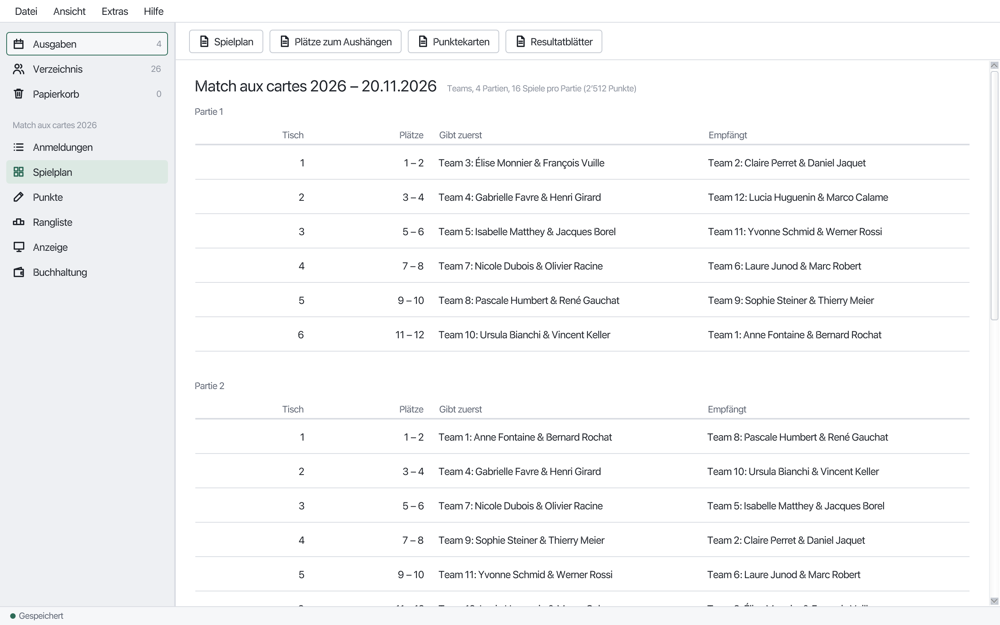

<table>
<tr><td align="center" valign="top">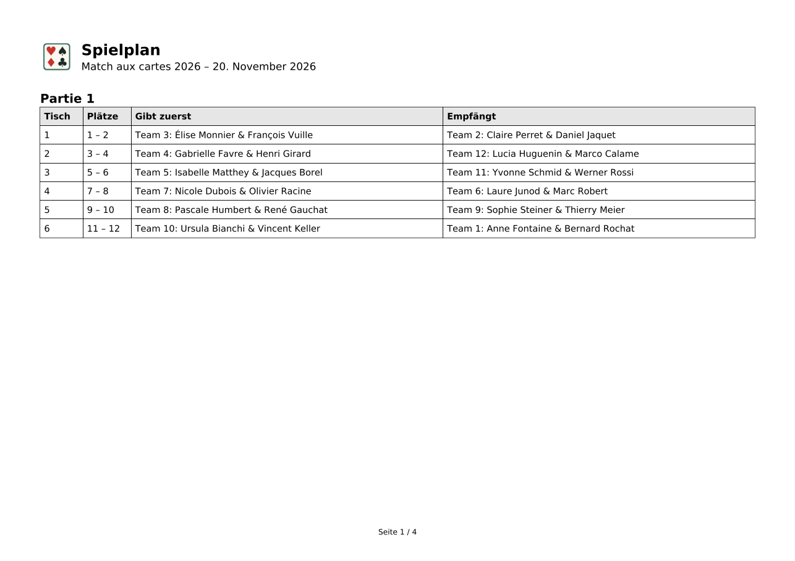 Spielplan</td><td align="center" valign="top">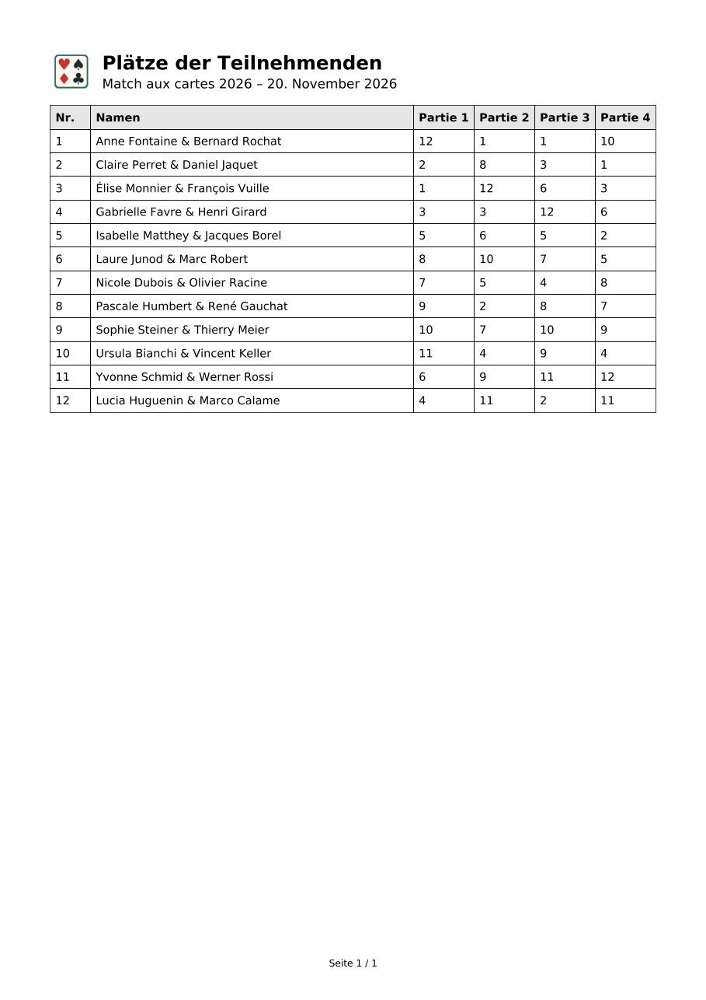 Plätze zum Aushängen</td></tr>
<tr><td align="center" valign="top">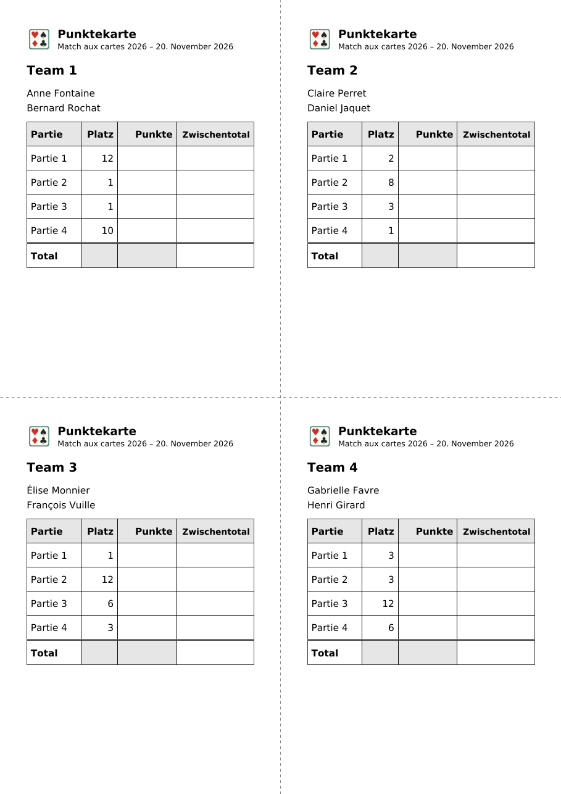 Punktekarten</td><td align="center" valign="top">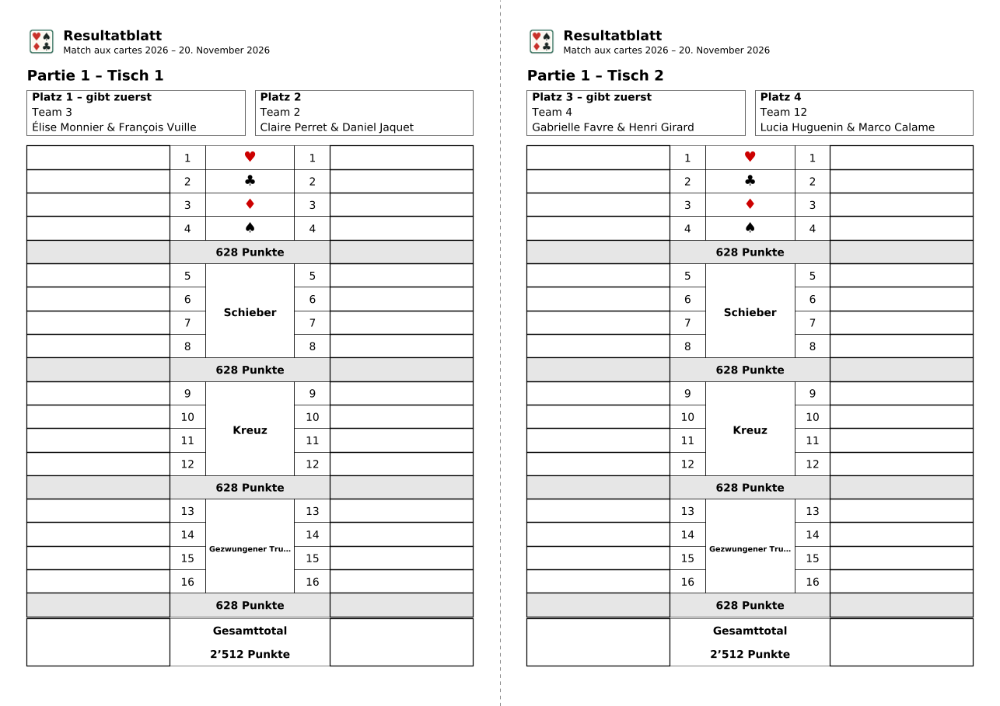 Resultatblätter</td></tr>
</table>

## 8. Am Turniertag: die Anzeige im Saal

Der Teil **Anzeige** steuert ein zweites Fenster für einen Projektor oder einen Fernseher:

1. **Anzeige öffnen**, den **Bildschirm** wählen, dann **Vollbild**.
2. Die **Dauer einer Partie (Minuten)** einstellen (60 als Vorgabe, mit der Ausgabe gespeichert).
3. Zu Beginn jeder Partie **Startsignal geben**: Die Anzeige zeigt die verbleibende Zeit, dann «Zeit abgelaufen».
   **Startsignal aufheben** nach einem Irrtum.

Die Anzeige zeigt das Logo der Dokumente, die Ausgabe, die laufende Partie und Platz und Tisch jeder teilnehmenden
Person oder jedes Teams; zu lange Listen wechseln alle 10 Sekunden die Seite, und ein Balken neben der Seitennummer
leert sich bis zur nächsten Seite. Gezeigt wird die laufende Partie;
**Partie anzeigen** wählt eine andere.

Am Ende des Turniers **Rangliste anzeigen**, dann mit **Rang enthüllen** einen Rang nach dem anderen, vom letzten zum
ersten. Während der Enthüllung bleibt die Anzeige auf der ersten Seite: Der zuletzt enthüllte Rang steht immer oben,
und fehlt der Platz, verschwinden die unteren Ränge vom Bildschirm. Ist alles enthüllt, wird dieselbe Schaltfläche zu
**Seiten durchblättern**: Klicken Sie darauf, wenn Sie wollen, damit die Seiten der ganzen Rangliste alle 10 Sekunden
wechseln. **Alles verbergen** beginnt die Enthüllung von vorn, auf der ersten Seite.

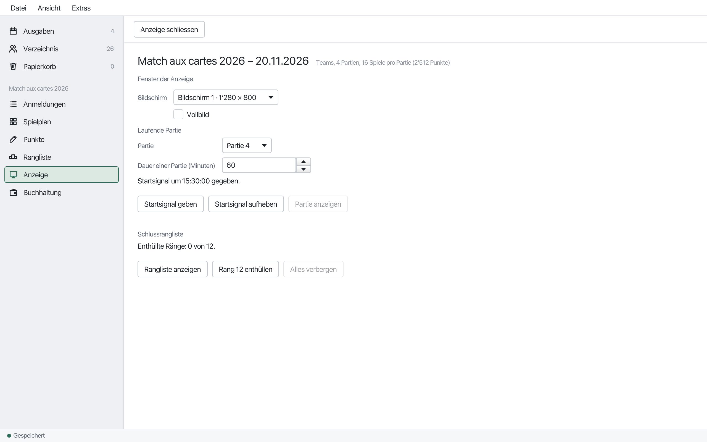

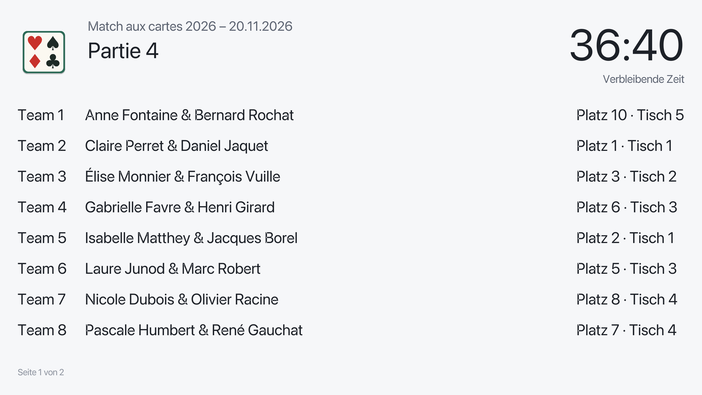

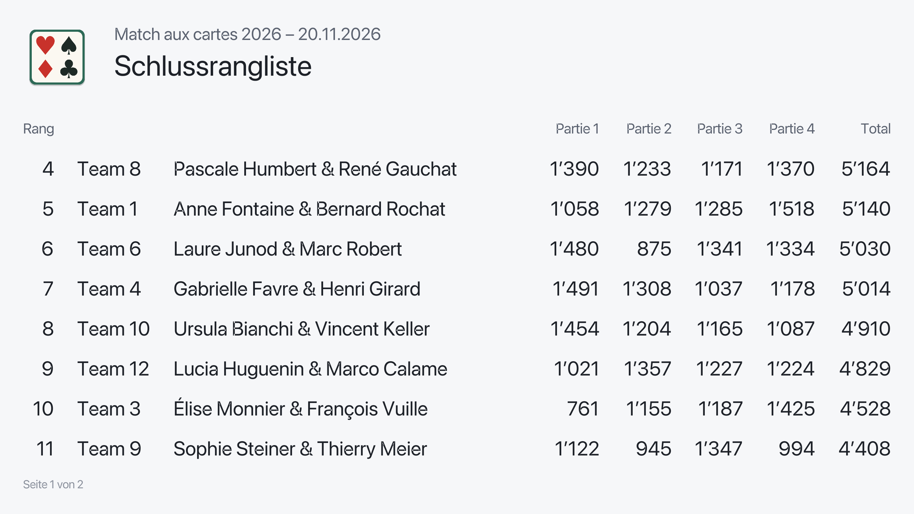

## 9. Die Punkte erfassen

Der Teil **Punkte** listet die Partien mit ihren Teams und ihrem Resultat. Wählen Sie eine Partie (oder **Nächstes
Blatt erfassen**): Ihr Blatt erscheint rechts, wie das Papierblatt.

- **Spalte A** ist das Team, das zuerst gibt (ungerader Platz), **Spalte B** sein Gegner. Eine getippte Spalte
  ergänzt die andere automatisch (157 minus ihr Wert, grau).
- **Erfassen Sie Spalte A und prüfen Sie Spalte B.** Tippen Sie die Punkte des gebenden Teams Spiel für Spiel und
  drücken Sie die Eingabetaste für das nächste (Pfeiltasten nach oben und unten zum Wechseln). Vergleichen Sie
  danach jeden grauen Wert der Spalte B mit dem Papierblatt: Ein Unterschied deckt einen Tippfehler oder einen
  Fehler der Spieler auf. Tippen Sie dann den Wert des Blatts in Spalte B.
- Jeder Wert wird sofort gespeichert. Die Zwischentotale pro Block von 4 Spielen, die Totale, der **Abzug (Regel
  16)** und die **gezählten Punkte** werden berechnet.
- Ein Spiel, dessen zwei Spalten nicht 157 Punkte ergeben, wird hervorgehoben, und die Partie ist in der Liste mit
  _Blatt prüfen_ markiert.
- Eine Partie, deren Resultat erfasst ist (alle Spiele ohne Fehler, oder ein Forfait), ist in der Liste mit einem
  grünen Häkchen _Resultat erfasst_ markiert: Die noch zu übertragenden Blätter sind auf einen Blick erkennbar.
- **Abwesend (Regel 19)**: Das gegnerische Team erhält 1’256 Punkte.
- **Blatt löschen** beginnt die Erfassung einer Partie von vorn.

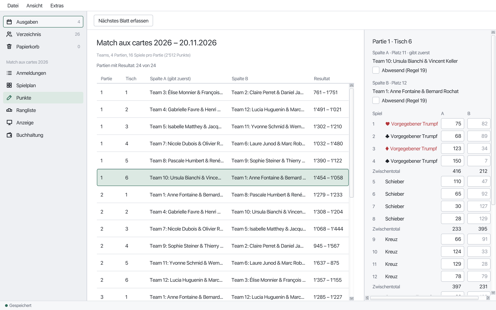

## 10. Die Rangliste erstellen

Die **Rangliste** wird bei jeder Anzeige neu berechnet: provisorisch, solange Partien ohne Resultat sind, dann
definitiv. Sie zeigt den Rang, die Punkte jeder Partie und das Total.

- **Gleichstände** (Regel 15): Sobald alle Partien ein Resultat haben, **Gleichstände auslosen**. Die Auslosung
  schliesst den Match ab: Die Blätter können nicht mehr geändert werden. Um danach einen Punktestand zu korrigieren,
  **Auslosung aufheben**, korrigieren und erneut auslosen.
- **Wegen Betrugs ausschliessen** (Regel 17): Alle Partien der Teilnehmenden sind verloren, ihre Gegner erhalten
  1’256 Punkte, und sie werden aus der Rangliste entfernt. **Ausschluss aufheben** nimmt sie wieder auf.

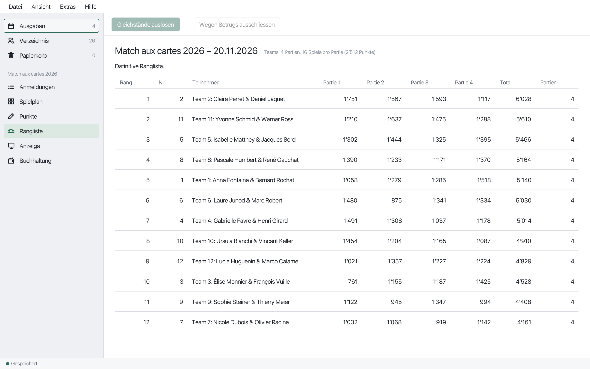

## 11. Die Buchhaltung führen

Der Teil **Buchhaltung** vereint die Rechnung der Ausgabe:

- **Startgeld pro Spieler (CHF)** und ein Kästchen pro Person, um festzuhalten, wer bezahlt hat;
- **Neue Buchung**: Datum, Einnahme oder Ausgabe, Kategorie (die schon benutzten Kategorien werden vorgeschlagen),
  Beschreibung und Betrag (`1'234.50` oder `1234,50`), dann **Buchung hinzufügen**;
- **Belege** einer gespeicherten Buchung: **Beleg hinzufügen…** oder PDF-, PNG- oder JPEG-Dateien hineinziehen
  (höchstens 20 MB pro Datei). Sie werden in der Ausgabe aufbewahrt; **Öffnen** zeigt sie mit der Anwendung des
  Systems;
- die **Übersicht**: bezahlte und ausstehende Startgelder, Einnahmen und Ausgaben pro Kategorie, Saldo (rot, wenn er
  negativ ist).

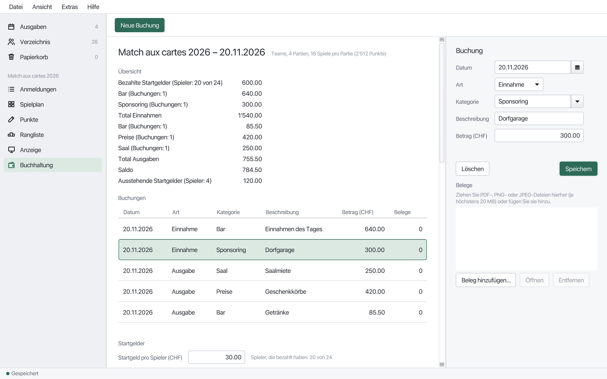

## 12. Sichern, exportieren, eine Ausgabe wiederfinden

Die Ausgaben und das Verzeichnis werden im Datenordner der Anwendung aufbewahrt; es ist kein Pfad zu wählen.

| System | Ordner |
|--------|--------|
| macOS | `~/Library/Application Support/Jass Tournament` |
| Windows | `%APPDATA%\Jass Tournament` |
| Linux | `~/.local/share/jass-tournament` |

- **Datei › Ausgabe exportieren…** erstellt eine vollständige `.jass`-Datei (mit den Belegen), die an eine andere
  organisierende Person weitergegeben werden kann; diese öffnet sie mit **Ausgabe importieren…**. Eine ältere
  Version der Anwendung öffnet die Dateien einer neueren Version nicht (zum Beispiel 1.0.5 jene von 1.1.0): Die andere
  Person installiert zuerst die neueste Version. Eine neuere Version öffnet dagegen die Dateien der älteren Versionen.
- **Datei › Alles sichern…** erstellt ein ZIP-Archiv des ganzen Ordners: vor und nach dem Turnier zu machen, zum
  Beispiel auf einen USB-Stick.
- **Ausgabe in den Papierkorb** verschiebt sie in den **Papierkorb**, aus dem sie mit **Wiederherstellen**
  zurückgeholt werden kann; **Papierkorb leeren** löscht sie endgültig.

## 13. Tastenkürzel

«Cmd» unter macOS, «Ctrl» unter Windows und Linux.

| Kürzel | Aktion |
|--------|--------|
| Cmd/Ctrl+N | Neues Element der Ansicht (Ausgabe, Anmeldung, Person, Buchung) |
| Cmd/Ctrl+S | Formular speichern (Anmeldung, Person, Buchung) |
| Cmd/Ctrl+O | Importieren |
| Cmd/Ctrl+E | Exportieren |
| Cmd/Ctrl+F | Suchen |
| Cmd/Ctrl+1, 2, 3 | Ausgaben, Verzeichnis, Papierkorb |
| Cmd/Ctrl+B | Seitenleiste ein- oder ausblenden |
| Cmd/Ctrl+, | Einstellungen oder Optionen |
| Eingabetaste | Gewähltes Element öffnen; zum nächsten Spiel wechseln |
| Löschtaste | Gewähltes Element löschen (nach einer Bestätigung) |
| F6, Umschalt+F6 | Von einem Feld zum nächsten wechseln |

## 14. Häufige Meldungen

| Meldung | Was tun |
|---------|---------|
| Es gibt zu wenige Teams (oder Spielende) für die Anzahl Partien. | Mehr Teilnehmende anmelden oder die Anzahl Partien verringern. |
| Die Anzahl Partien muss gerade sein. | Eine gerade Anzahl Partien wählen. |
| Mit dieser Anzahl Spielender ist keine Nachholpartie möglich. | Im Einzelmodus eine Person mehr oder weniger anmelden. |
| Kein Spielplan wurde rechtzeitig gefunden. | Die Berechnung erneut starten. |
| Öffnen Sie die Anmeldung wieder, bevor Sie Teilnehmende oder Partien ändern. | Der Spielplan ist berechnet: **Anmeldung wieder öffnen**. |
| Die Auslosung hat den Match abgeschlossen. | In der Rangliste **Auslosung aufheben**, um ein Blatt zu korrigieren. |
| Unlesbare Ausgabedateien | Eine Datei ist beschädigt oder stammt aus einer neueren Version der Anwendung: **Hilfe › Nach Updates suchen…** und installieren Sie die neueste Version. |
| Die Aktualisierung konnte nicht heruntergeladen werden. | Prüfen Sie die Internetverbindung: Die Aktualisierung wird beim nächsten Start erneut angeboten. |

## 15. Personendaten

Die Anwendung funktioniert ohne Internet und sendet keine Daten. Bei jedem Start fragt sie nur GitHub, ob eine neuere
Version veröffentlicht ist: GitHub sieht die Adresse der Verbindung (IP-Adresse), wie bei jedem Besuch einer Webseite.
E-Mail-Adressen und Telefonnummern werden nur im Verzeichnis dieses Computers aufbewahrt: nie in den Dateien der
Ausgaben, nie auf den gedruckten Dokumenten. Eine Person kann ihre Daten verlangen (**Verzeichnis exportieren…**),
ihre Löschung (**Kontaktdaten löschen**, **Person löschen**) oder nicht mehr kontaktiert zu werden (Status _Nicht
kontaktieren_).
