

# Jass Tournament — User guide

English · [Français](fr.md) · [Deutsch](de.md) · [Italiano](it.md)

**Jass Tournament** runs a _Chibre_ tournament from start to finish: registration, schedule (who plays whom in each
round, and which team deals first), documents to print, score entry, ranking, display in the hall and accounting. It
follows the regulation of the _match aux cartes des vétérans du FC Bevaix_ and works without an Internet connection.

This guide follows the course of a tournament: prepare, register, print, play, rank, close the accounts.
The screenshots show a fictitious tournament, as presented on Windows and Linux; on macOS, the menus are in the menu bar of the system.

## Contents

1. [Install the application](#1-install-the-application)
2. [Get to know the window](#2-get-to-know-the-window)
3. [Choose the logo of the documents](#3-choose-the-logo-of-the-documents)
4. [Keep the directory](#4-keep-the-directory)
5. [Create an edition](#5-create-an-edition)
6. [Register the participants](#6-register-the-participants)
7. [Compute the schedule and print the documents](#7-compute-the-schedule-and-print-the-documents)
8. [On the day: the display in the hall](#8-on-the-day-the-display-in-the-hall)
9. [Enter the scores](#9-enter-the-scores)
10. [Establish the ranking](#10-establish-the-ranking)
11. [Keep the accounts](#11-keep-the-accounts)
12. [Back up, export, find an edition](#12-back-up-export-find-an-edition)
13. [Keyboard shortcuts](#13-keyboard-shortcuts)
14. [Common messages](#14-common-messages)
15. [Personal data](#15-personal-data)

## 1. Install the application

Download the installer of your system from the
[releases page](https://github.com/porchy13/jass-tournament/releases):

| System | File | Installation |
|--------|------|--------------|
| macOS (Apple Silicon or Intel) | `.dmg` | Open the file, then drag **Jass Tournament** into the Applications folder. |
| Windows | `.msi` | Open the file and follow the steps. |
| Linux (Debian, Ubuntu) | `.deb` | `sudo apt install ./<file>.deb` |

The application is not signed yet:

- **macOS** refuses to open it the first time. Right-click the application, then choose **Open**; on recent versions
  of macOS, open **System Settings › Privacy & Security** and choose **Open Anyway**.
- **Windows** shows a SmartScreen warning: choose **More info**, then **Run anyway**.

The application speaks the language of the system: French, German, Italian, or English for any other language.

### Update the application

At each start, the application checks whether a newer version is published. If so, it offers it with its novelties:
**Download and install** downloads the installer (its progress is shown, **Cancel** stops it), then the application
saves everything, opens the installer and closes; follow the steps of the installation as above. **Not now** postpones
the update to the next start. Without Internet, the application starts normally and shows nothing.

**Help › Check for updates…** starts the check at any time: the application offers the new version, or says that it is
already the latest one, or that the check failed (for instance without Internet).

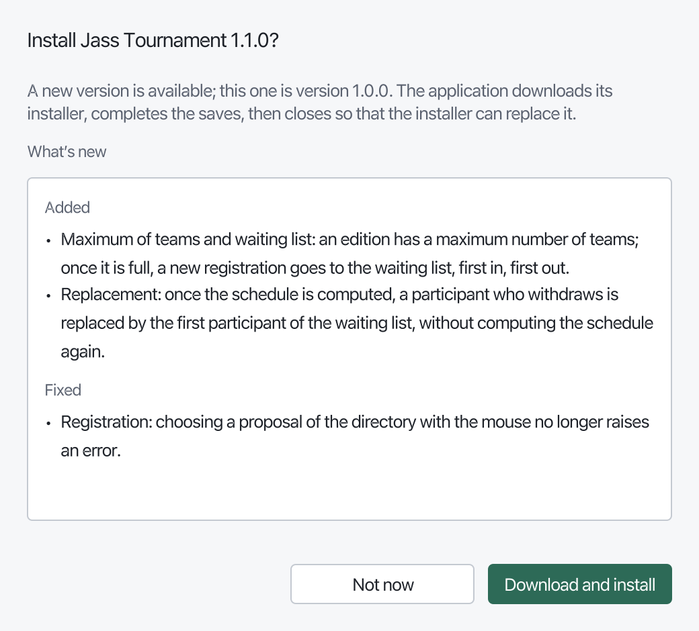

## 2. Get to know the window

- **The menus** (at the top; on macOS, in the menu bar of the system): **File**, **View**, **Tools** (except on
  macOS) and **Help**.
- **The side navigation** (on the left): **Editions**, **Directory** and **Trash**. While an edition is open, its name
  appears with its parts: **Registration**, **Schedule**, **Scores**, **Ranking**, **Display** and **Accounting**. They
  are used in this order during the tournament.
- **The list** (in the centre): the content of the chosen part.
- **The detail panel** (on the right): the element selected in the list, ready to be changed. In a narrow window, it
  floats above the list.
- **The status bar** (at the bottom): tells whether everything is **Saved**, what is selected, and the notices.

**There is nothing to save by hand**: every change is saved at once. The actions that delete something always ask for
a confirmation.

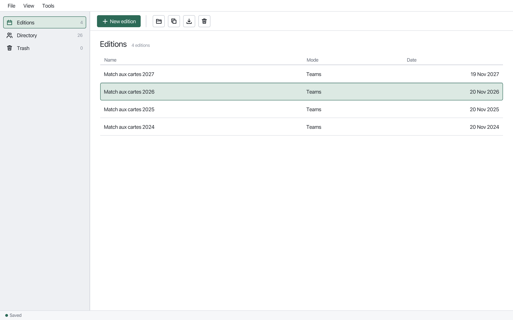

**Help › About** shows the version of the application, its author, its licence and the link to its source code;
**Make a donation** opens the page of the donations in the browser.

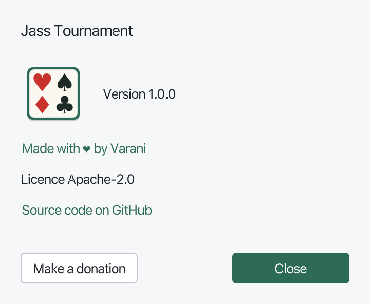

## 3. Choose the logo of the documents

The logo of your club or of your tournament is printed **at the top left of every document** (schedule, places to
post, score cards, score sheets) and shown on **the display in the hall**. Choose it before printing the documents:

1. Open **Settings…** (menu **File** on macOS) or **Options…** (menu **Tools** on Windows and Linux).
2. Under **Logo of the documents**, choose **Choose an image…** and select the image.
3. The logo is shown in the panel; the status bar confirms that it will be printed on the documents.

The image must be a **PNG or JPEG file of at most 2 MB**. A PNG image **with a transparent background** suits best, as
it blends into every document; a large enough image stays sharp when printed.

The logo is the same for **every edition**: it is kept in the data folder of the application, not in the editions. An
edition exported to another computer does not take it along: choose it on that computer too. **Back up everything…**
includes it in the backup.

**Remove the logo** (after a confirmation) prints the documents without a logo.

These settings also hold the appearance of the application: **Theme** (as the system, light or dark), **Use the accent
colour of the system** and **Reduce the animations**.

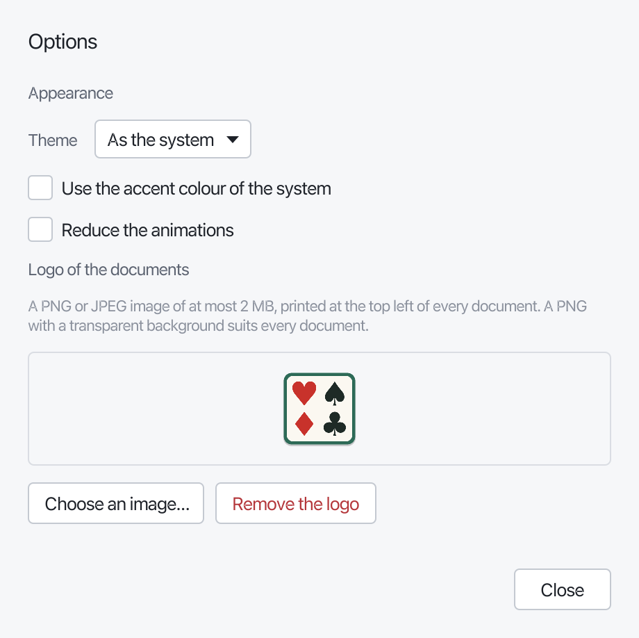

## 4. Keep the directory

The **Directory** keeps the persons from one edition to the next: they are proposed during the registration, and they
can be contacted again for the next tournament.

- **New person** (primary button): first name (mandatory), last name, e-mail, phone, notes, status, then **Save**.
  Several persons can be typed one after the other, from the keyboard only. If a similar person already exists, the
  application says so before creating a duplicate.
- **Search** a name; filter the persons of an edition.
- **Status**: _Contactable_, _Do not contact_ (at the request of the person) or _Deceased_. The last two keep the
  person out of the contact lists; a deceased person is no longer proposed during the registration.
- **Copy the e-mail addresses** or **Copy the phone numbers** of the selected persons, to paste them into a message
  (the persons not to be contacted are left out).
- **Merge the two selected persons** joins two records of the same person.
- **Erase the contact details** or **Delete the person** erases them for good.
- **Import persons…** from a CSV file or from rows copied from a spreadsheet: choose the columns, check the preview
  (invalid values and possible duplicates reported), then **Import**. The duplicates are imported only when **Import
  the possible duplicates too** is ticked.
- **Export the directory…** as CSV, for instance to answer a person who asks for the data kept about them.

The directory starts empty; it can also be filled during the registrations.

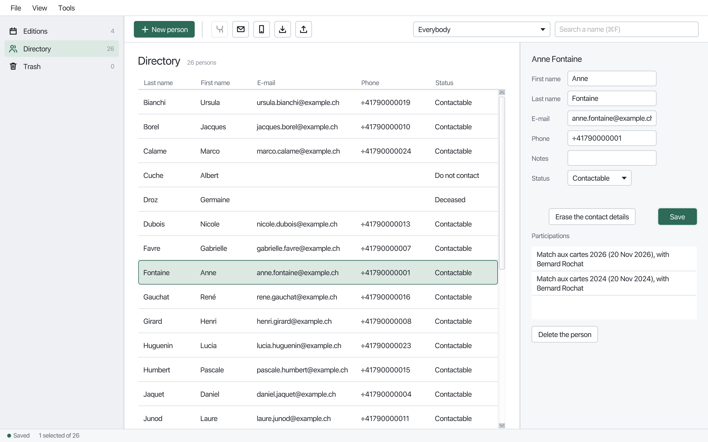

## 5. Create an edition

In **Editions**, choose **New edition**:

- **Name** and **Date**;
- **Mode**: _Teams_ (the teams of two players register together) or _Individual_ (each player registers alone; the
  application forms the teams, with another partner in each round, and limits how often two players meet as
  opponents);
- **Games per participant**: 4 according to the regulation; the number must be even, as each team deals first in
  half of its games;
- **Maximum of teams**: 20 by default (twice as many players in individual mode); beyond it, the registrations go to
  the waiting list;
- **Content of the games**: the type of each deal (imposed trump ♥ ♣ ♦ ♠, _Schieber_, _Kreuz_, forced trump).
  **Plan of the regulation** restores the 16 deals of the regulation; **Add 4 deals** and **Remove 4 deals** change
  their number, always a multiple of 4.

**Create** stays unavailable while a value is missing; the reason is shown.

For the next year, select the previous edition and choose **Duplicate the edition**: the new one takes over the mode,
the games, the maximum of teams, the content of the games and the registration fee, but not the registrations.

The list of the editions shows for each one its number of **Registrations**, its number of registrations **Waiting**
and its maximum of teams (**Maximum**). Open an edition with a double click or the Enter key.

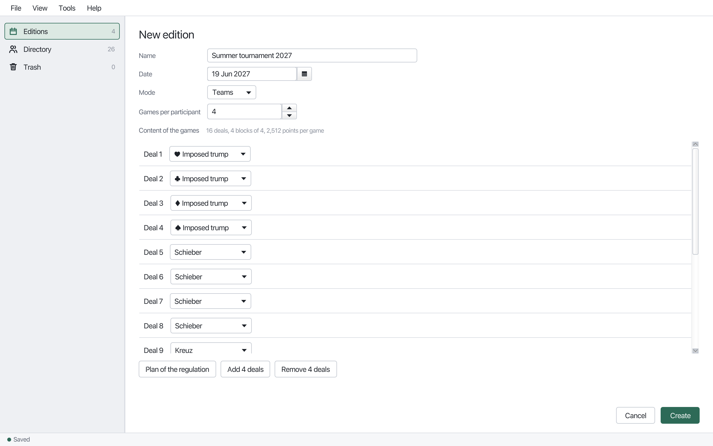

## 6. Register the participants

In **Registration**, the panel on the right receives the players (two per team, one in individual mode):

1. Type the first or last name: up to 8 persons of the directory are proposed, except those already
   registered in the edition; choose one, or keep typing for a new
   person, who will be added to the directory.
2. If the player has played before, the application proposes to **register the previous team again** with the former
   partner.
3. **Register** (Cmd+S on macOS, Ctrl+S elsewhere) adds the registration; **New registration** clears the panel.

Select a registration to **Correct** or **Remove** it. If the names of a player have been corrected in the directory
since, the registration is marked _Names corrected in the directory_: **Correct** takes the new names.

A person marked as deceased in the directory cannot be registered. If you type their first and last names, the
application asks whether it is another person with the same names: **Another person** adds them to the directory and
registers them, otherwise nothing is registered. A registration whose player has been marked as deceased since is
marked _Person deceased in the directory_: to correct it, replace this person (it can still be removed).

The number of registrations is shown, with the maximum and the minimum needed to compute the schedule (for instance
5 teams for 4 games).

### Waiting list

The **Maximum of teams** is changed above the list while the registration is open. Once the edition is full, the panel
says so and **Register** adds the entry to the waiting list: the next registrations wait under the list of the
registered participants, in their order of arrival (first come, first served). Select a waiting registration to
**Correct** it or **Remove** it from the list.

When a registered participant is removed, the first waiting registration takes its place. Raising the maximum
registers the first ones waiting; lowering it puts the last registered participants back at the head of the waiting
list.

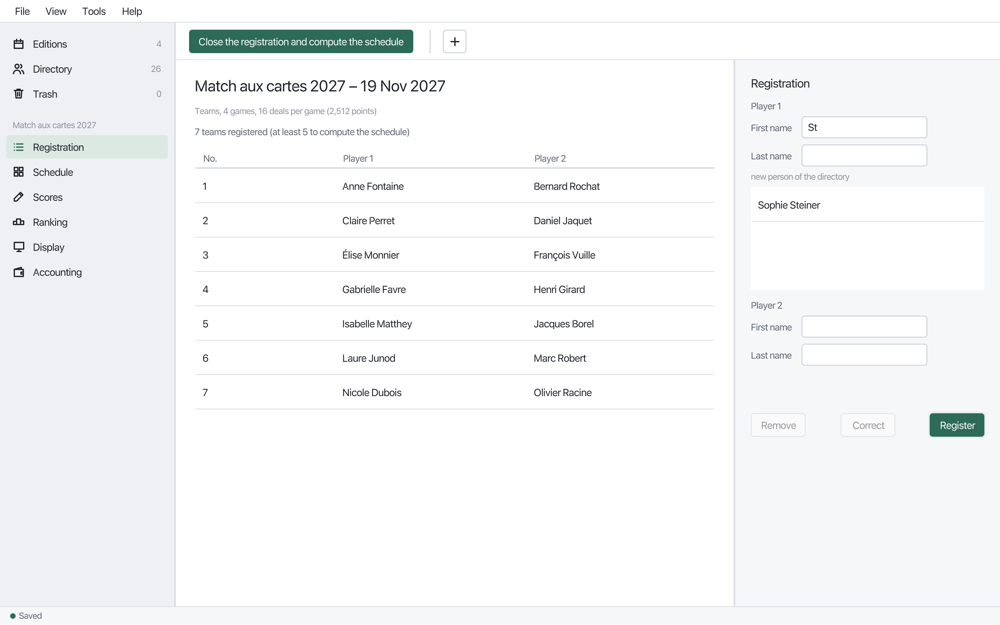

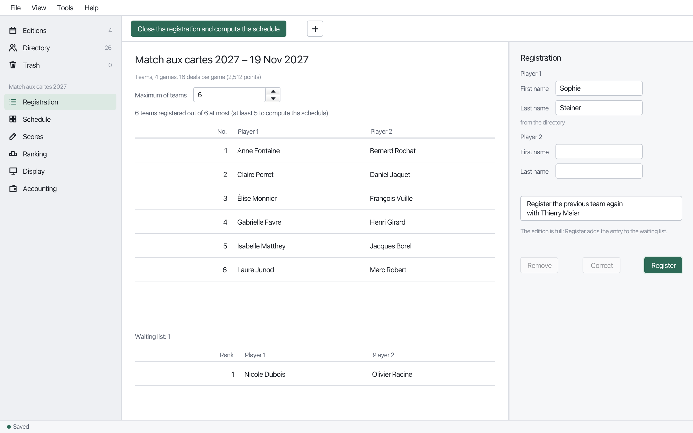

## 7. Compute the schedule and print the documents

Once everybody is registered, choose **Close the registration and compute the schedule**. The computation takes one
minute at most; a bar shows its progress, and **Stop the computation** interrupts it.

The schedule follows the regulation: each team plays the planned number of games, never meets the same team twice and
deals first in half of its games. At each table, the team at the smallest place deals first. With an odd number of
teams, one team sits out each of the first rounds, and the teams that sat out play each other in a catch-up round.

The part **Schedule** shows each round with its tables, its places, the team that deals first and the one that
receives, and the participants sitting out. It exports the following documents as PDF; each one carries the
[chosen logo](#3-choose-the-logo-of-the-documents), its title and the name of the edition:

| Document | Use |
|----------|-----|
| **Schedule** | The whole schedule, round by round. |
| **Places to post** | One line per participant with its place in each round (a dash when it sits out): to post at the entrance of the hall. |
| **Score cards** | One card per participant, four per A4 page to cut: its place in each round, and the boxes where it writes its points and its total. |
| **Score sheets** | One sheet per round and table, two per A4 landscape page to cut: both teams with their places, then the deals of the content of the games, filled in during the play. |

A late registration? After the closing, it goes to the waiting list.

A withdrawal? Select the participant in **Registration**: **Replace by the first of the waiting list**, or type other
players and choose **Replace**. The new participant takes the number and the places of the one who withdraws, without
computing the schedule again; the replacement is possible as long as no result of its games is entered. The
participant replaced leaves the edition, but stays in the directory; the registration fees are paid on the day of the
tournament: the new participant, registered as not paid, pays its fee, and the one who withdraws pays nothing. Under
**Documents of the participant**, **Export the score card** and **Export the score sheets** print only the documents
that change: its card and the sheets of its games. The schedule and the places to post do not change their form; print
them again whole when needed, for instance without a screen in the hall.

To compute everything again, **Reopen the registration** (as long as no score is entered) deletes the schedule, which
is computed again at the next closing. Print all the documents again then.

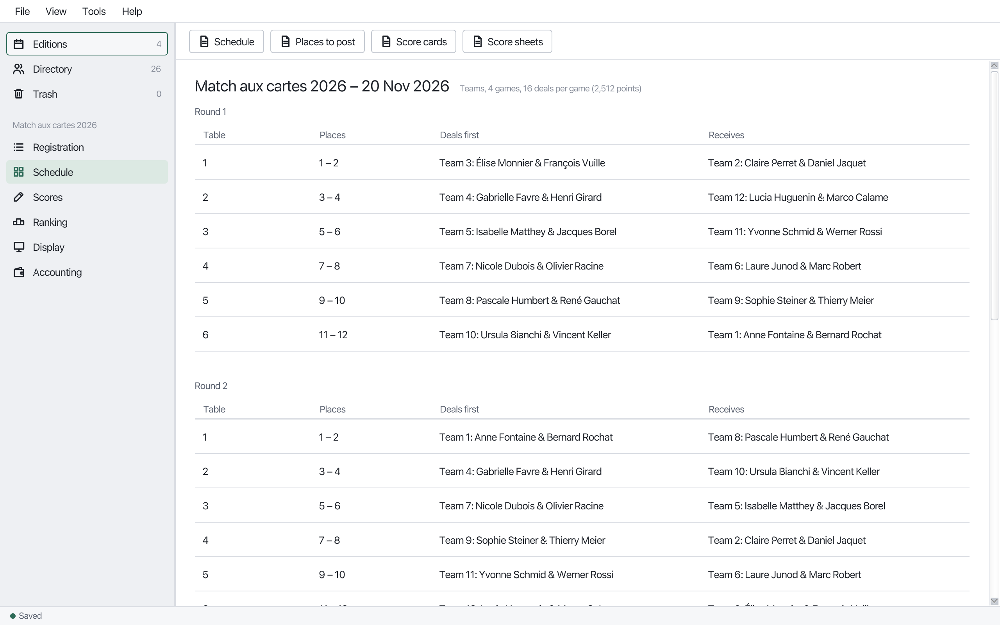

<table>
<tr><td align="center" valign="top">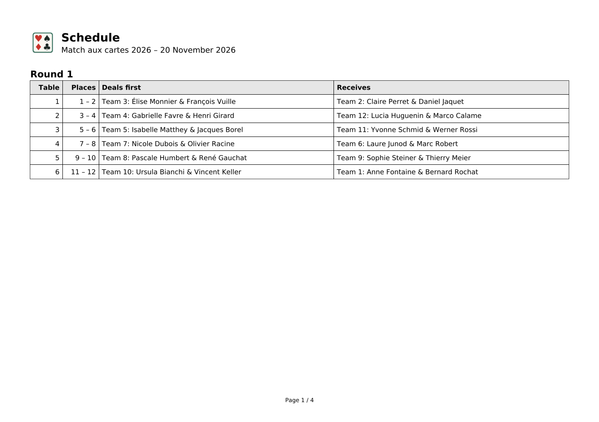 Schedule</td><td align="center" valign="top">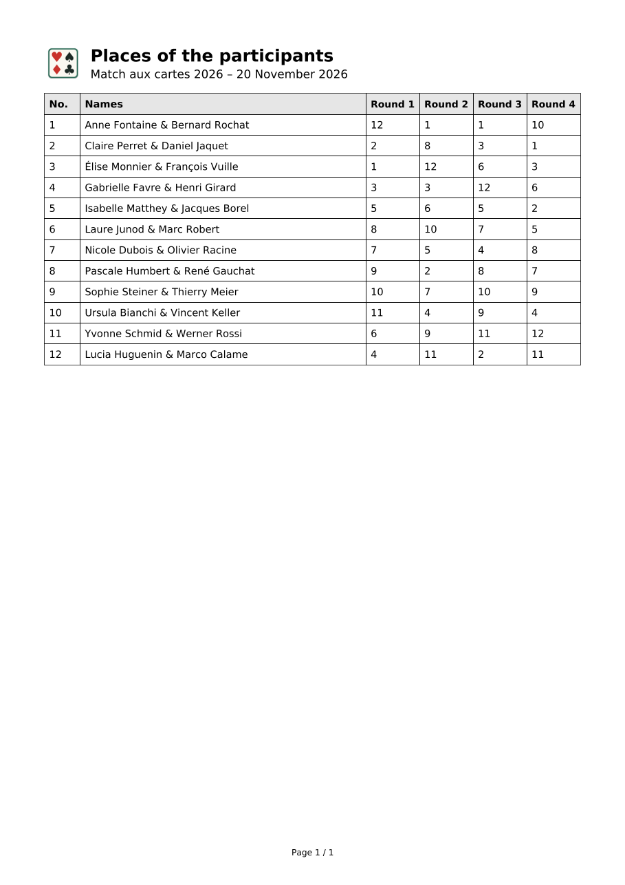 Places to post</td></tr>
<tr><td align="center" valign="top">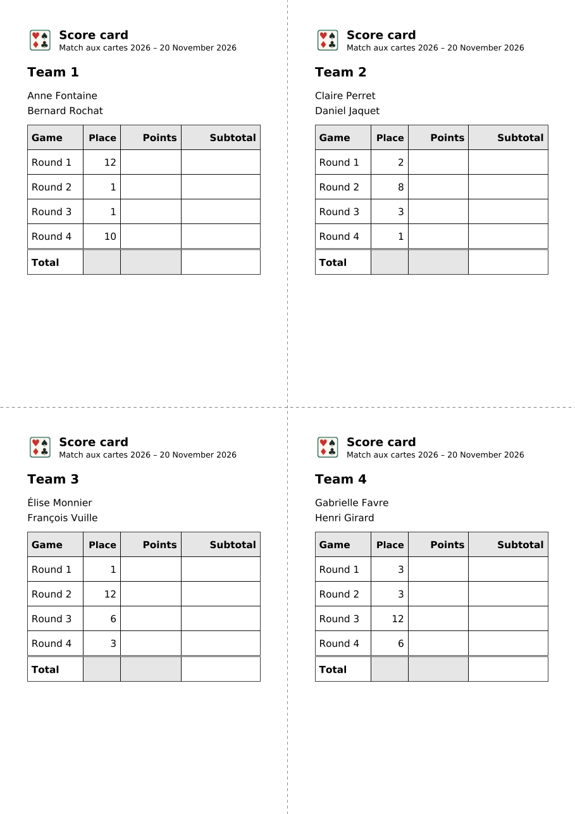 Score cards</td><td align="center" valign="top">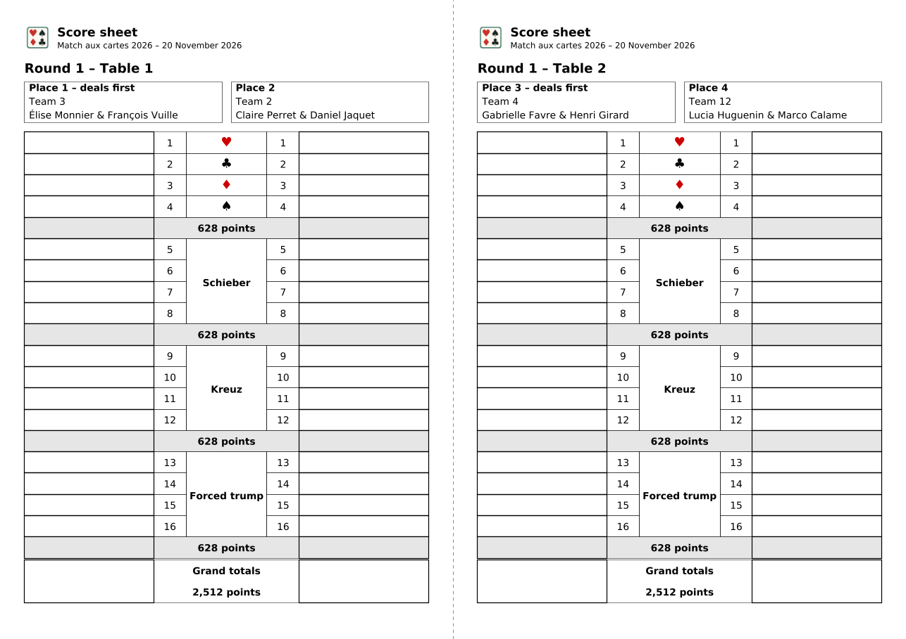 Score sheets</td></tr>
</table>

## 8. On the day: the display in the hall

The part **Display** controls a second window, to move to a projector or a television:

1. **Open the display**, choose the **Screen**, then **Full screen**.
2. Set the **Time of a game (minutes)** (60 by default, kept with the edition).
3. At the start of each round, **Give the start signal**: the display shows the time remaining, then "Time is over".
   **Cancel the start signal** after a mistake.

The display shows the logo of the documents, the edition, the round in progress and the place and table of every
participant; the lists that do not fit alternate by pages every 10 seconds, a bar next to the number of the page
emptying until the next page. The round shown is the one in progress;
**Show the round** chooses another one.

At the end of the tournament, **Show the ranking**, then **Reveal rank** one by one, from the last to the first.
During the reveal, the display stays on the first page: the rank revealed last is always at the top, and when there is
no room left, the lower ranks leave the screen. Once everything is revealed, the same button becomes **Turn the
pages**: click it when you wish, and the pages of the whole ranking alternate every 10 seconds. **Hide everything**
starts the reveal again, on the first page.

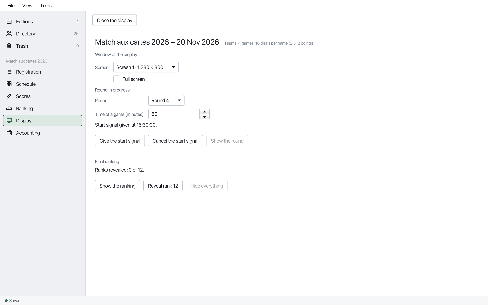

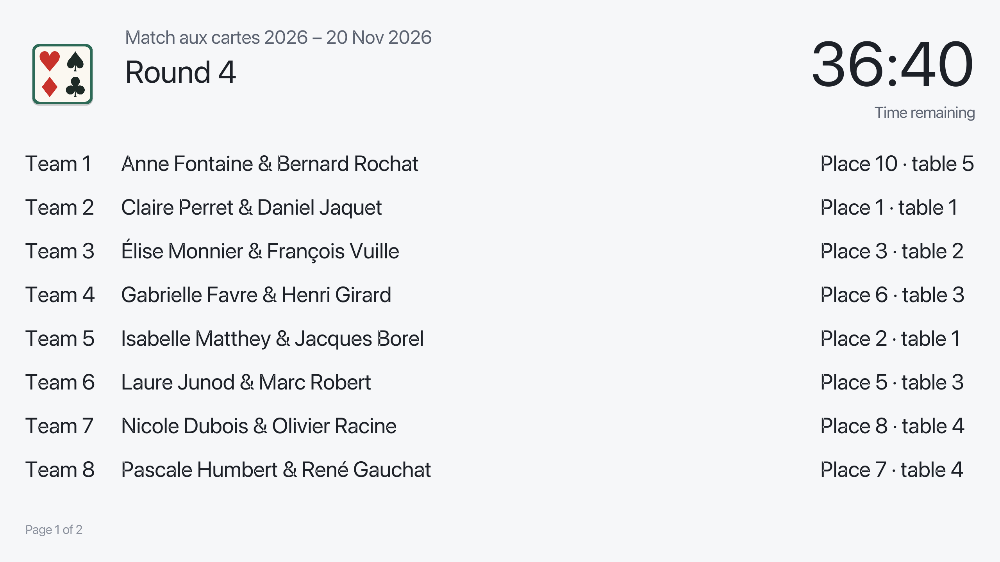

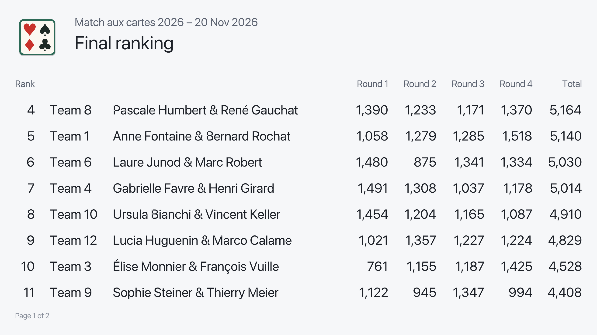

## 9. Enter the scores

The part **Scores** lists the games with their teams and their result. Choose a game (or **Next sheet to enter**): its
sheet appears on the right, like the paper sheet.

- **Column A** is the team that deals first (odd place). Type its points, deal by deal, and press Enter to move to the
  next one (Up and Down arrows to move around).
- **Column B** is filled in automatically (157 − A, in grey); type it only when the sheet says otherwise.
- Every value is saved at once. The subtotals per block of 4 deals, the totals, the **Deduction (rule 16)** and the
  **points counted** are computed.
- A deal whose two columns do not make 157 points is highlighted, and the game is marked _Sheet to check_ in the
  list.
- **Absent (rule 19)**: the opposing team receives 1,256 points.
- **Clear the sheet** starts the entry of a game again.

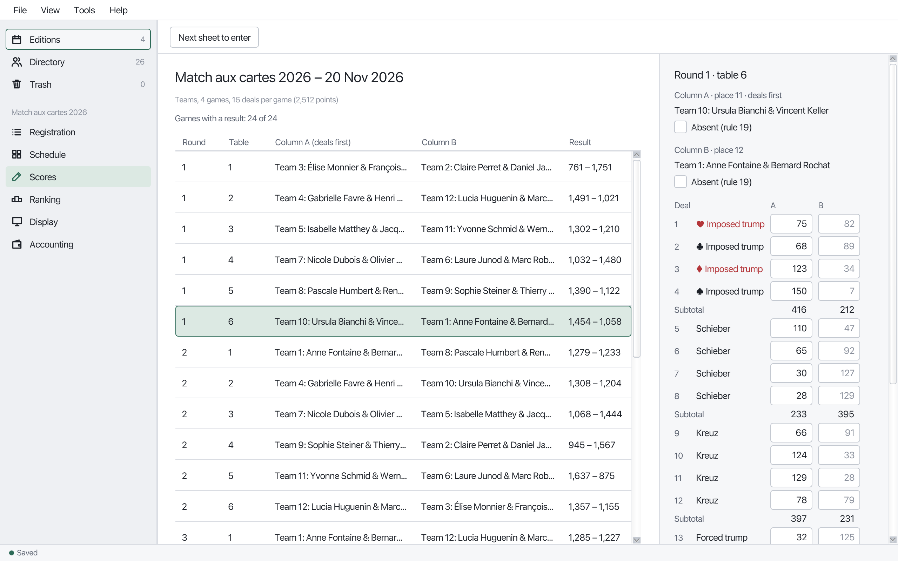

## 10. Establish the ranking

The **Ranking** is computed each time it is shown: provisional while some games have no result, then final. It gives
the rank, the points of each game and the total.

- **Ties** (rule 15): once every game has a result, **Draw lots for the ties**. The draw closes the match: the sheets
  can no longer be changed. To correct a score afterwards, **Cancel the draw**, correct, then draw lots again.
- **Exclude for cheating** (rule 17): every game of the participant is lost, its opponents receive 1,256 points and it
  is removed from the ranking. **Cancel the exclusion** brings it back.

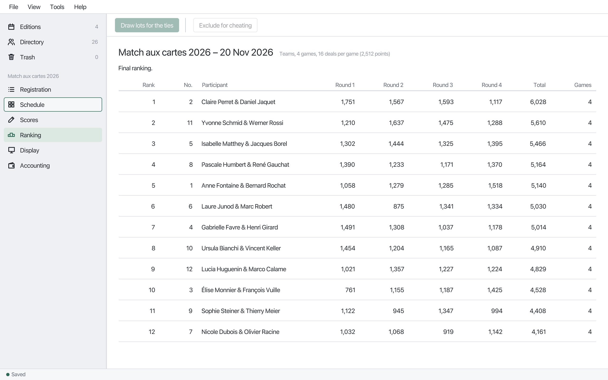

## 11. Keep the accounts

The part **Accounting** holds the accounts of the edition:

- **Fee per player (CHF)** and one box per player to note who has paid;
- **New entry**: date, income or expense, category (the categories already used are proposed), description and amount
  (`1'234.50` or `1234,50`), then **Add the entry**;
- **Supporting documents** of a saved entry: **Add a document…** or drop PDF, PNG or JPEG files (20 MB at most each).
  They are kept in the edition; **Open** shows them with the application of the system;
- the **Summary**: fees paid and outstanding, incomes and expenses per category, balance (in red when negative).

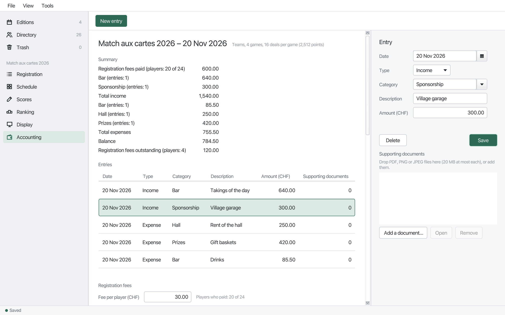

## 12. Back up, export, find an edition

The editions and the directory are kept in the data folder of the application; no path has to be chosen.

| System | Folder |
|--------|--------|
| macOS | `~/Library/Application Support/Jass Tournament` |
| Windows | `%APPDATA%\Jass Tournament` |
| Linux | `~/.local/share/jass-tournament` |

- **File › Export the edition…** creates a complete `.jass` file (supporting documents included), to pass on to
  another organiser, who opens it with **Import an edition…**.
- **File › Back up everything…** creates a ZIP archive of the whole folder: do it before and after the tournament, on
  a USB stick for instance.
- **Move the edition to the trash** moves it to the **Trash**, from which it can be restored (**Restore**); **Empty the
  trash** deletes it for good.

## 13. Keyboard shortcuts

"Cmd" on macOS, "Ctrl" on Windows and Linux.

| Shortcut | Action |
|----------|--------|
| Cmd/Ctrl+N | New element of the view (edition, registration, person, entry) |
| Cmd/Ctrl+S | Save the form (registration, person, entry) |
| Cmd/Ctrl+O | Import |
| Cmd/Ctrl+E | Export |
| Cmd/Ctrl+F | Search |
| Cmd/Ctrl+1, 2, 3 | Editions, Directory, Trash |
| Cmd/Ctrl+B | Show or hide the side bar |
| Cmd/Ctrl+, | Settings or Options |
| Enter | Open the selected element; move to the next deal |
| Delete | Delete the selected element (after a confirmation) |
| F6, Shift+F6 | Move from one panel to the next |

## 14. Common messages

| Message | What to do |
|---------|------------|
| There are not enough teams (or players) for the number of games. | Register more participants or reduce the number of games. |
| The number of games must be even. | Choose an even number of games. |
| No catch-up round can be formed. | In individual mode, register one player more or one less. |
| No schedule was found in time. | Start the computation again. |
| Reopen the registration before changing the participants or the games. | The schedule is computed: **Reopen the registration**. |
| The drawing of lots has closed the match. | **Cancel the draw** in the ranking to correct a sheet. |
| Unreadable edition files | A file is damaged, or comes from a newer version of the application: **Help › Check for updates…** and install the latest version. |
| The update could not be downloaded. | Check the connection to the Internet: the update is offered again at the next start. |

## 15. Personal data

The application works without Internet and sends no data. At each start, it only asks GitHub whether a newer version
is published: GitHub sees the address of the connection (IP address), as for any visit of a web page. The e-mail
addresses and phone numbers are kept only in the directory of this computer: never in the edition files, never on the
printed documents. A person may ask for their data (**Export the directory…**), for their erasure (**Erase the contact
details**, **Delete the person**) or not to be contacted any more (status _Do not contact_).
