

# Tournoi de Jass — Guide d’utilisation

[English](en.md) · Français · [Deutsch](de.md) · [Italiano](it.md)

Le **Tournoi de Jass** organise un tournoi de _Chibre_ du début à la fin : inscriptions, tableau des rencontres
(qui joue contre qui à chaque partie, et quelle équipe donne en premier), documents à imprimer, saisie des points,
classement, affichage dans la salle et comptabilité. Il suit le règlement du _match aux cartes des vétérans du FC
Bevaix_ et fonctionne sans connexion Internet.

Ce guide suit le déroulement d’un tournoi : préparer, inscrire, imprimer, jouer, classer, boucler les comptes.
Les captures d’écran montrent un tournoi fictif, avec la présentation de Windows et de Linux ; sur macOS, les menus sont dans la barre de menus du système.

## Sommaire

1. [Installer l’application](#1-installer-lapplication)
2. [Découvrir la fenêtre](#2-découvrir-la-fenêtre)
3. [Choisir le logo des documents](#3-choisir-le-logo-des-documents)
4. [Tenir l’annuaire](#4-tenir-lannuaire)
5. [Créer une édition](#5-créer-une-édition)
6. [Inscrire les participants](#6-inscrire-les-participants)
7. [Calculer les rencontres et imprimer les documents](#7-calculer-les-rencontres-et-imprimer-les-documents)
8. [Le jour du tournoi : l’affichage dans la salle](#8-le-jour-du-tournoi--laffichage-dans-la-salle)
9. [Saisir les points](#9-saisir-les-points)
10. [Établir le classement](#10-établir-le-classement)
11. [Tenir la comptabilité](#11-tenir-la-comptabilité)
12. [Sauvegarder, exporter, retrouver une édition](#12-sauvegarder-exporter-retrouver-une-édition)
13. [Raccourcis clavier](#13-raccourcis-clavier)
14. [Messages fréquents](#14-messages-fréquents)
15. [Données personnelles](#15-données-personnelles)

## 1. Installer l’application

Téléchargez l’installateur de votre système sur la page des
[versions publiées](https://github.com/porchy13/jass-tournament/releases) :

| Système | Fichier | Installation |
|---------|---------|--------------|
| macOS (Apple Silicon ou Intel) | `.dmg` | Ouvrez le fichier, puis glissez **Jass Tournament** dans le dossier Applications. |
| Windows | `.msi` | Ouvrez le fichier et suivez les étapes. |
| Linux (Debian, Ubuntu) | `.deb` | `sudo apt install ./<fichier>.deb` |

L’application n’est pas encore signée :

- **macOS** refuse de l’ouvrir la première fois. Faites un clic droit sur l’application, puis **Ouvrir** ; sur les
  versions récentes de macOS, ouvrez **Réglages Système › Confidentialité et sécurité** et choisissez **Ouvrir
  quand même**.
- **Windows** affiche un avertissement SmartScreen : choisissez **Informations complémentaires**, puis **Exécuter
  quand même**.

L’application parle la langue du système : français, allemand, italien, ou anglais pour toute autre langue.

### Mettre à jour l’application

À chaque démarrage, l’application vérifie si une version plus récente est publiée. Si c’est le cas, elle la propose
avec ses nouveautés : **Télécharger et installer** télécharge l’installateur (la progression est affichée, **Annuler**
l’interrompt), puis l’application enregistre tout, ouvre l’installateur et se ferme ; suivez les étapes de
l’installation comme ci-dessus. **Plus tard** reporte la mise à jour au prochain démarrage. Sans Internet,
l’application démarre normalement et n’affiche rien.

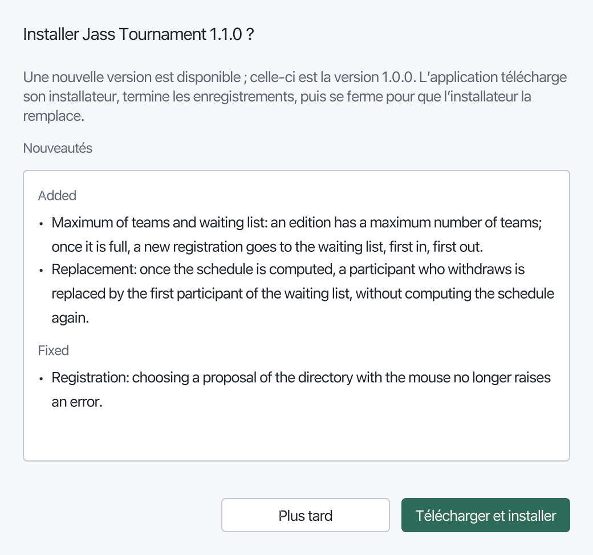

## 2. Découvrir la fenêtre

- **Les menus** (en haut ; sur macOS, dans la barre de menus du système) : **Fichier**, **Affichage**, **Outils** (hors
  macOS) et **Aide**.
- **La navigation latérale** (à gauche) : **Éditions**, **Annuaire** et **Corbeille**. Quand une édition est ouverte,
  son nom apparaît avec ses parties : **Inscriptions**, **Rencontres**, **Points**, **Classement**, **Affichage** et
  **Comptabilité**. On les parcourt dans cet ordre au fil du tournoi.
- **La liste** (au centre) : le contenu de la partie choisie.
- **Le panneau de détail** (à droite) : l’élément sélectionné dans la liste, prêt à être modifié. Dans une fenêtre
  étroite, il flotte au-dessus de la liste.
- **La barre d’état** (en bas) : indique si tout est **Enregistré**, ce qui est sélectionné, et les messages
  d’information.

**Il n’y a rien à enregistrer à la main** : chaque changement est enregistré aussitôt. Les actions qui suppriment
quelque chose demandent toujours une confirmation.

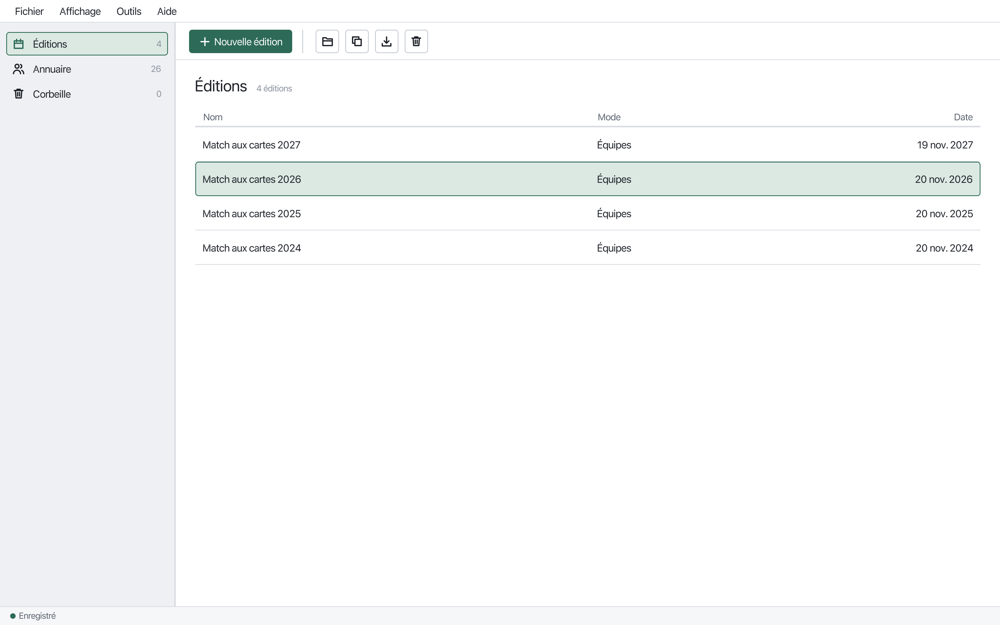

**Aide › À propos** affiche la version de l’application, son auteur, sa licence et le lien vers son code source ;
**Faire un don** ouvre la page des dons dans le navigateur.

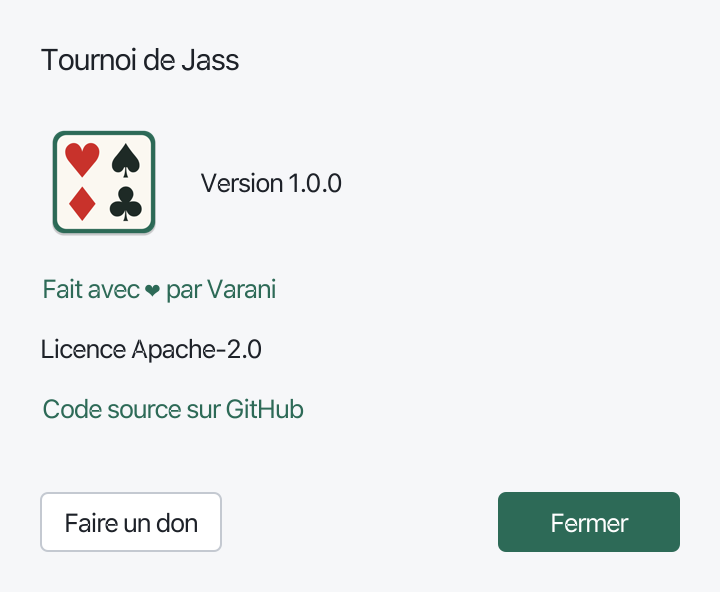

## 3. Choisir le logo des documents

Le logo de votre club ou de votre tournoi figure **en haut à gauche de chaque document imprimé** (tableau des
rencontres, places à afficher, cartes de points, feuilles de résultats) et sur **l’affichage de la salle**. Choisissez-le
avant d’imprimer les documents :

1. Ouvrez **Réglages…** (menu **Fichier** sur macOS) ou **Options…** (menu **Outils** sous Windows et Linux).
2. Sous **Logo des documents**, choisissez **Choisir une image…** et sélectionnez l’image.
3. Le logo est montré dans le panneau ; la barre d’état confirme qu’il figurera sur les documents.

L’image doit être un fichier **PNG ou JPEG de 2 Mo au plus**. Une image PNG **à fond transparent** convient le mieux,
car elle se fond dans tous les documents ; une image assez grande reste nette à l’impression.

Le logo est le même pour **toutes les éditions** : il est gardé dans le dossier de l’application, pas dans les
éditions. Une édition exportée vers un autre ordinateur ne l’emporte donc pas : choisissez-le aussi sur cet
ordinateur. **Tout sauvegarder…** l’inclut dans la sauvegarde.

**Retirer le logo** (après confirmation) imprime les documents sans logo.

Ces réglages comprennent aussi l’apparence de l’application : **Thème** (comme le système, clair ou sombre), **Utiliser
la couleur d’accent du système** et **Réduire les animations**.

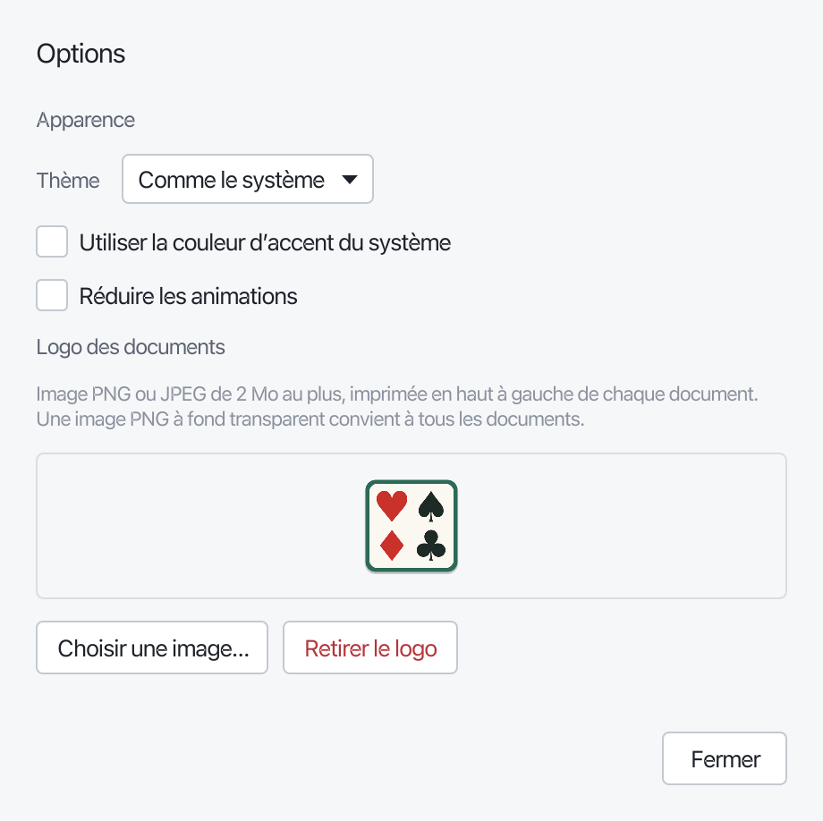

## 4. Tenir l’annuaire

L’**Annuaire** garde les personnes d’une édition à l’autre : on les retrouve à l’inscription, et on peut les
recontacter pour le tournoi suivant.

- **Nouvelle personne** (bouton principal) : prénom (obligatoire), nom, e-mail, téléphone, remarques, statut, puis
  **Enregistrer**. On peut saisir plusieurs personnes à la suite, au clavier seulement. Si une personne semblable
  existe déjà, l’application le signale avant de créer un doublon.
- **Rechercher** un nom ; filtrer les personnes d’une édition.
- **Statut** : _Contactable_, _Ne pas contacter_ (à la demande de la personne) ou _Décédé_. Ces deux derniers statuts
  écartent la personne des listes de contacts ; une personne décédée n’est plus proposée à l’inscription.
- **Copier les adresses e-mail** ou **Copier les numéros de téléphone** des personnes sélectionnées, pour les coller
  dans un message (personnes à ne pas contacter exclues).
- **Fusionner les deux personnes sélectionnées** réunit deux fiches d’une même personne.
- **Effacer les coordonnées** ou **Supprimer la personne** les efface définitivement.
- **Importer des personnes…** depuis un fichier CSV ou des lignes copiées d’un tableur : choisissez les colonnes,
  vérifiez l’aperçu (valeurs non valables et doublons possibles signalés), puis **Importer**. Les doublons ne sont
  importés que si vous cochez **Importer aussi les doublons possibles**.
- **Exporter l’annuaire…** en CSV, par exemple pour répondre à une personne qui demande les données gardées sur elle.

L’annuaire commence vide ; on peut aussi le remplir au fil des inscriptions.

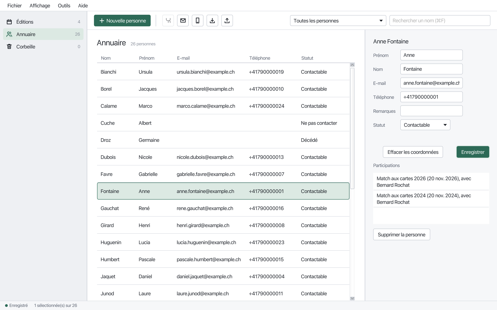

## 5. Créer une édition

Dans **Éditions**, choisissez **Nouvelle édition** :

- **Nom** et **Date** ;
- **Mode** : _Équipes_ (les équipes de deux joueurs s’inscrivent ensemble) ou _Individuel_ (chaque joueur s’inscrit
  seul ; l’application forme les équipes en changeant de partenaire à chaque partie et en limitant le nombre de fois
  où deux joueurs se rencontrent comme adversaires) ;
- **Parties par participant** : 4 selon le règlement ; le nombre doit être pair, car chaque équipe donne en premier
  dans la moitié de ses parties ;
- **Contenu des parties** : le type de chaque donne (atout imposé ♥ ♣ ♦ ♠, _Schieber_, _Kreuz_, atout forcé).
  **Plan du règlement** remet les 16 donnes du règlement ; **Ajouter 4 donnes** et **Retirer 4 donnes** changent leur
  nombre, toujours un multiple de 4.

**Créer** reste indisponible tant qu’une valeur manque ; la raison est affichée.

Pour l’année suivante, sélectionnez l’édition précédente et choisissez **Dupliquer l’édition** : la nouvelle reprend
le mode, les parties, le contenu des parties et la finance d’inscription, mais pas les inscriptions.

Ouvrez une édition par un double-clic ou la touche Entrée.

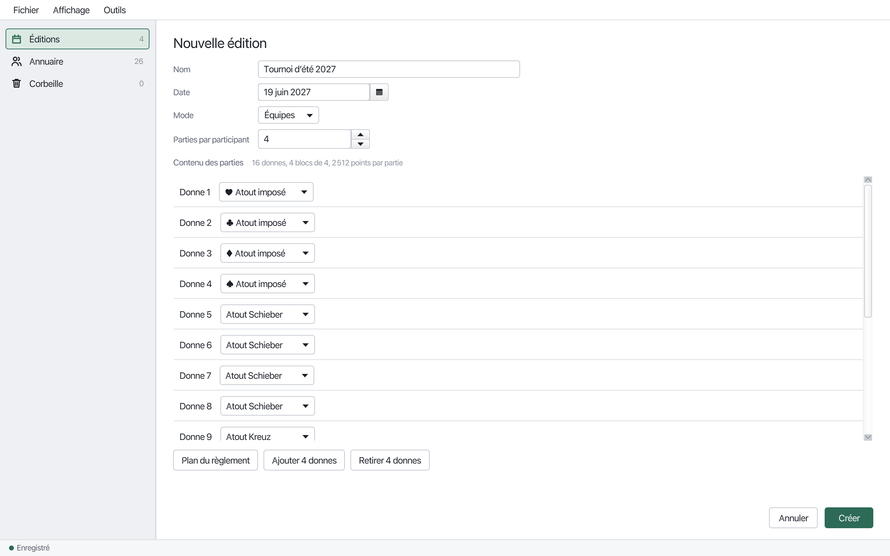

## 6. Inscrire les participants

Dans **Inscriptions**, le panneau de droite reçoit les joueurs (deux par équipe, un seul en mode individuel) :

1. Tapez le prénom ou le nom : jusqu’à 8 personnes de l’annuaire sont proposées, sauf celles
   déjà inscrites à l’édition ; choisissez-en une, ou continuez
   à taper pour une personne nouvelle, qui sera ajoutée à l’annuaire.
2. Si le joueur a déjà joué, l’application propose de **reprendre l’équipe précédente** avec son ancien partenaire.
3. **Inscrire** (Cmd+S sur macOS, Ctrl+S ailleurs) ajoute l’inscription ; **Nouvelle inscription** vide le panneau.

Sélectionnez une inscription pour la **Corriger** ou la **Retirer**. Si les noms d’un joueur ont été corrigés depuis
dans l’annuaire, l’inscription est marquée _Noms corrigés dans l’annuaire_ : **Corriger** reprend les nouveaux noms.

Une personne déclarée décédée dans l’annuaire ne peut pas être inscrite. Si vous tapez ses nom et prénom, l’application
demande s’il s’agit d’une autre personne du même nom : **Autre personne** l’ajoute à l’annuaire et l’inscrit, sinon
rien n’est inscrit. Une inscription dont un joueur a été déclaré décédé depuis est marquée _Personne décédée dans
l’annuaire_ : pour la corriger, remplacez cette personne (elle peut toujours être retirée).

Le nombre d’inscrits est affiché, avec le minimum nécessaire pour calculer les rencontres (par exemple 5 équipes pour
4 parties).

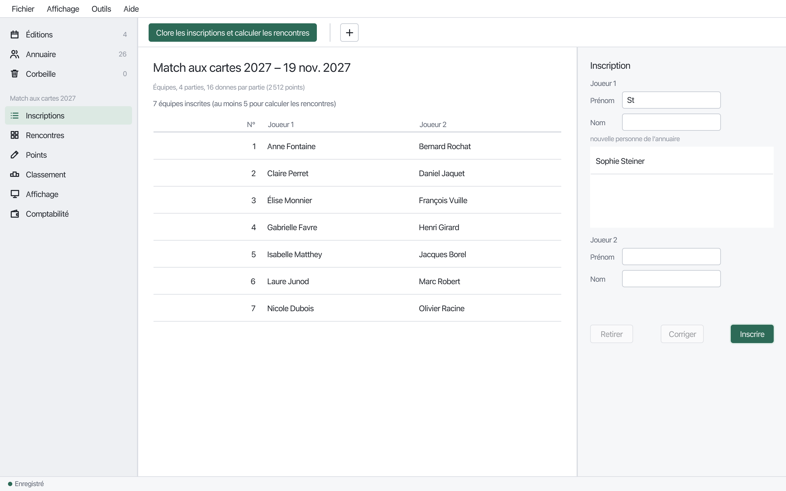

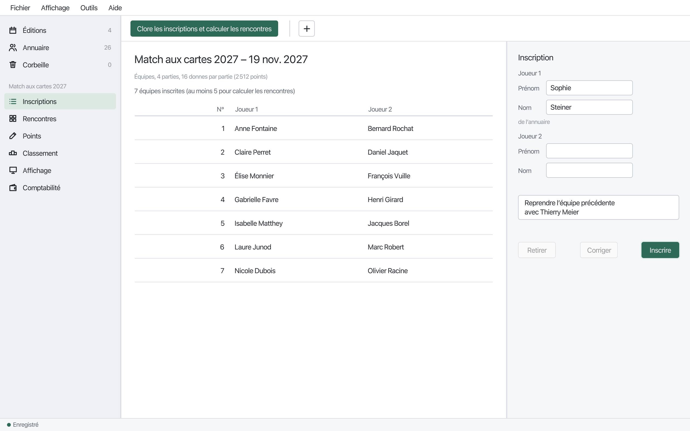

## 7. Calculer les rencontres et imprimer les documents

Quand tout le monde est inscrit, choisissez **Clore les inscriptions et calculer les rencontres**. Le calcul prend
au plus une minute ; une barre indique sa progression, et **Arrêter le calcul** l’interrompt.

Le tableau respecte le règlement : chaque équipe joue le nombre de parties prévu, ne rencontre jamais deux fois la
même équipe et donne en premier dans la moitié de ses parties. À chaque table, l’équipe à la plus petite place donne
en premier. Avec un nombre impair d’équipes, une équipe est au repos à chacune des premières parties, et les équipes
au repos jouent entre elles une partie de rattrapage.

La partie **Rencontres** montre chaque partie avec ses tables, ses places, l’équipe qui donne en premier et celle qui
reçoit, et les participants au repos. Elle exporte en PDF les documents suivants ; chacun porte le
[logo choisi](#3-choisir-le-logo-des-documents), son titre et le nom de l’édition :

| Document | Usage |
|----------|-------|
| **Tableau des rencontres** | Le tableau complet, partie par partie. |
| **Places à afficher** | Une ligne par participant avec sa place à chaque partie (un tiret quand il est au repos) : à afficher à l’entrée de la salle. |
| **Cartes de points** | Une carte par participant, quatre par page A4 à découper : sa place à chaque partie, et les cases où il note ses points et son total. |
| **Feuilles de résultats** | Une feuille par partie et par table, deux par page A4 paysage à découper : les deux équipes avec leur place, puis les donnes du contenu des parties, à remplir pendant le jeu. |

Une inscription tardive ou un désistement ? **Rouvrir les inscriptions** (tant qu’aucun point n’est saisi) supprime les
rencontres, qui sont recalculées à la clôture suivante. Réimprimez alors les documents.

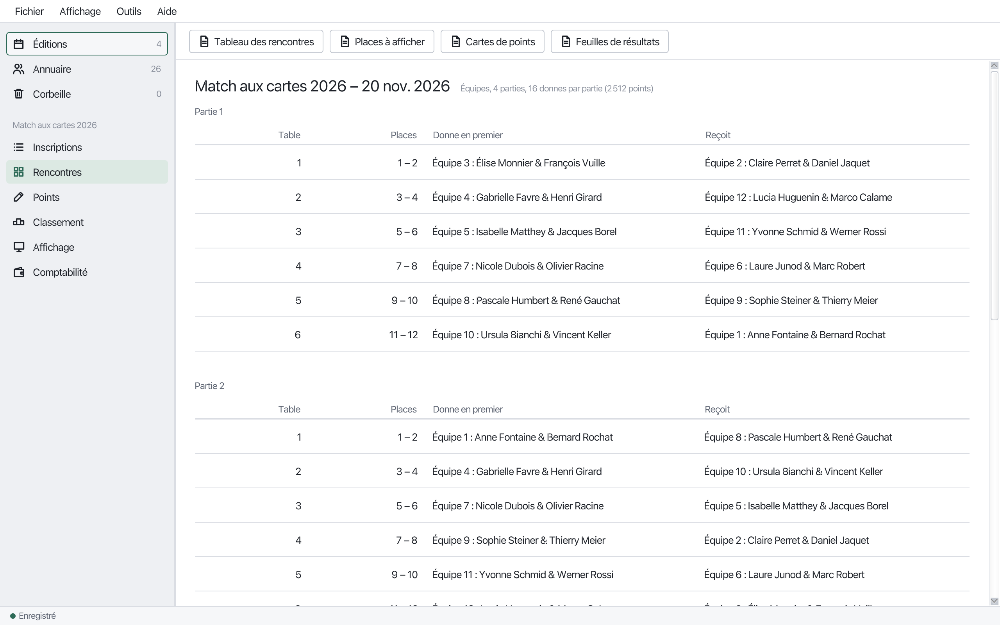

<table>
<tr><td align="center" valign="top">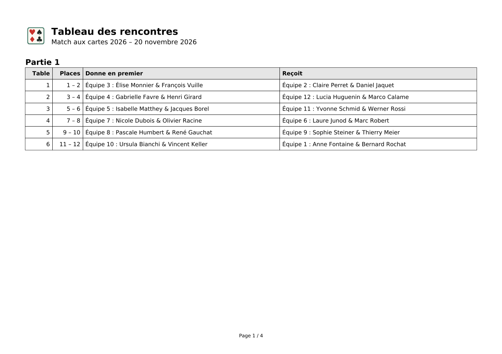 Tableau des rencontres</td><td align="center" valign="top">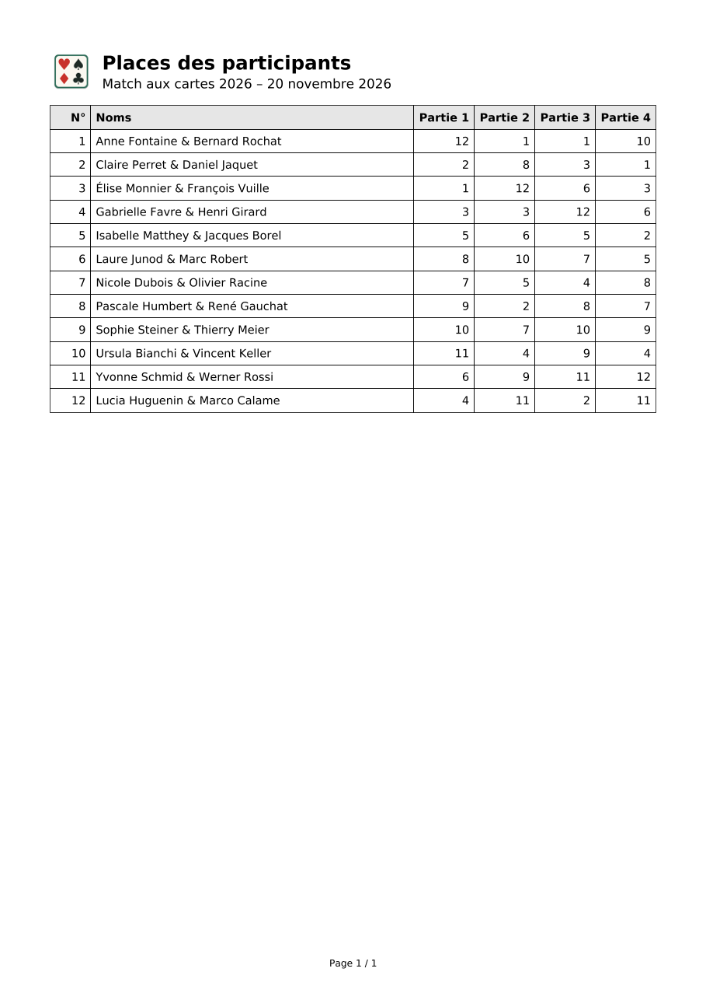 Places à afficher</td></tr>
<tr><td align="center" valign="top">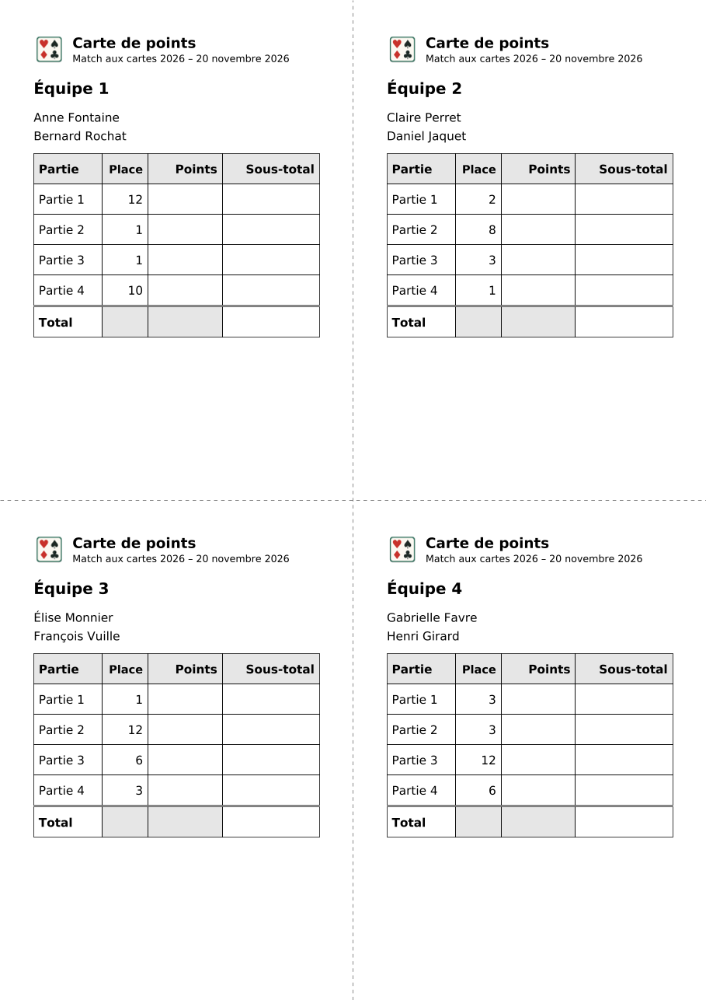 Cartes de points</td><td align="center" valign="top">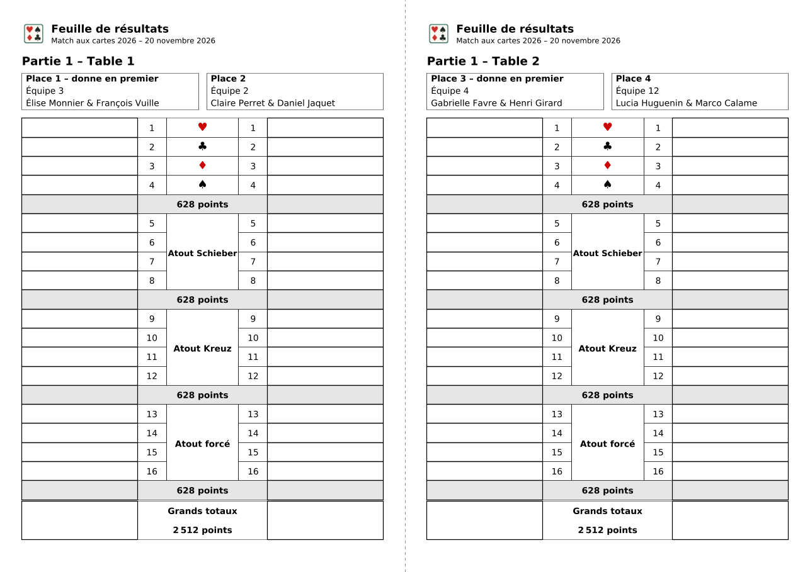 Feuilles de résultats</td></tr>
</table>

## 8. Le jour du tournoi : l’affichage dans la salle

La partie **Affichage** pilote une seconde fenêtre, à placer sur un projecteur ou un téléviseur :

1. **Ouvrir l’affichage**, choisir l’**Écran**, puis **Plein écran**.
2. Régler la **Durée d’une partie (minutes)** (60 par défaut, gardée avec l’édition).
3. Au début de chaque partie, **Donner le départ** : l’affichage montre le temps restant, puis « Temps écoulé ».
   **Annuler le départ** en cas d’erreur.

L’affichage montre le logo des documents, l’édition, la partie en cours et la place et la table de chaque participant ; les listes
trop longues défilent par pages toutes les 10 secondes, une barre à côté du numéro de la page se vidant jusqu’à la
page suivante. La partie montrée est celle en cours ; **Afficher la partie**
en choisit une autre.

À la fin du tournoi, **Afficher le classement** puis **Révéler le rang** un par un, du dernier au premier. Pendant la
révélation, l’affichage reste sur la première page : le rang révélé en dernier est toujours en haut, et si la place
manque, les rangs du bas disparaissent de l’écran. Une fois tout révélé, le même bouton devient **Faire défiler les
pages** : cliquez-le quand vous le souhaitez pour que les pages du classement complet défilent toutes les 10 secondes.
**Tout masquer** recommence la révélation, sur la première page.

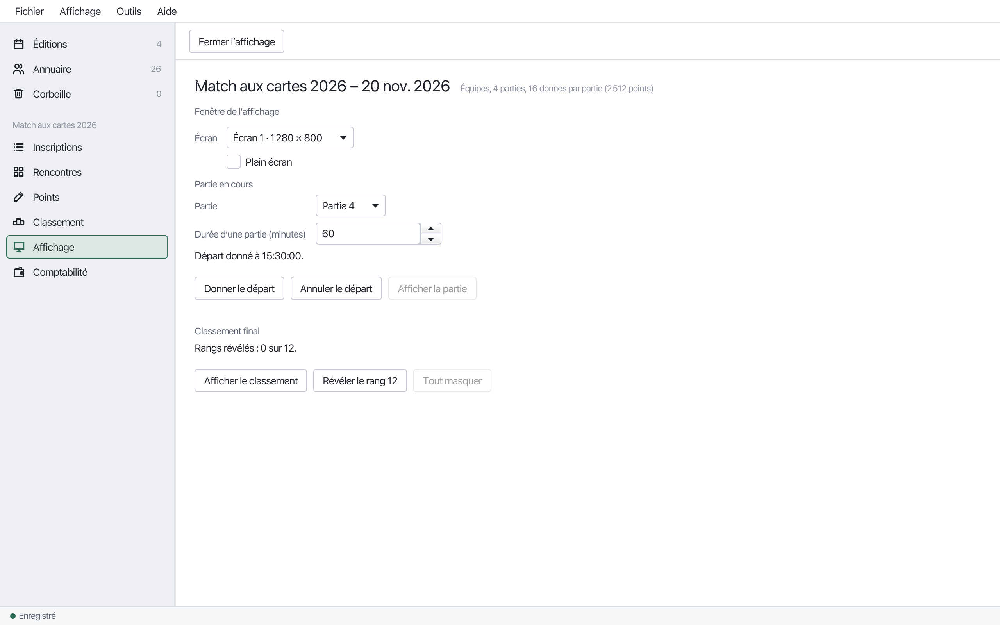

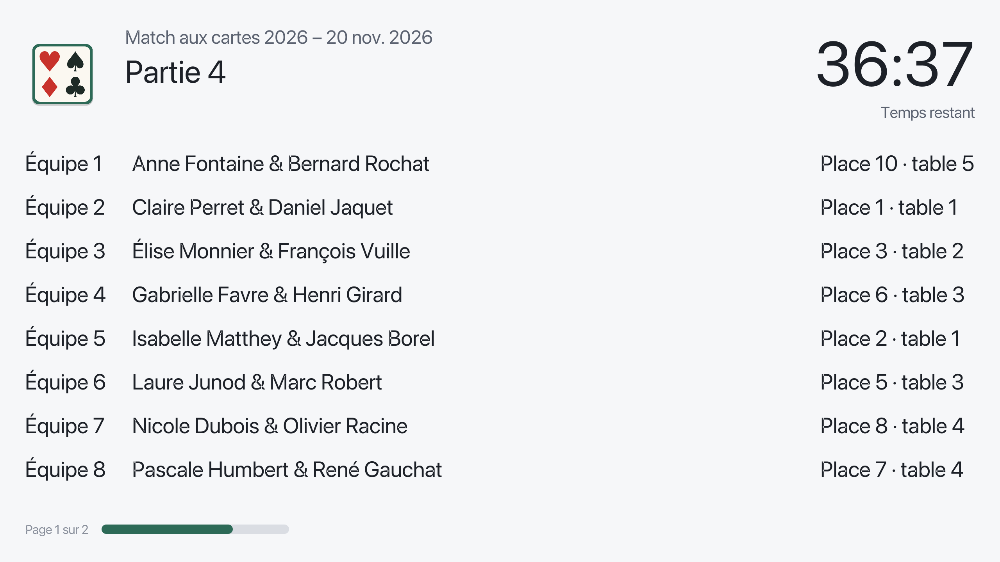

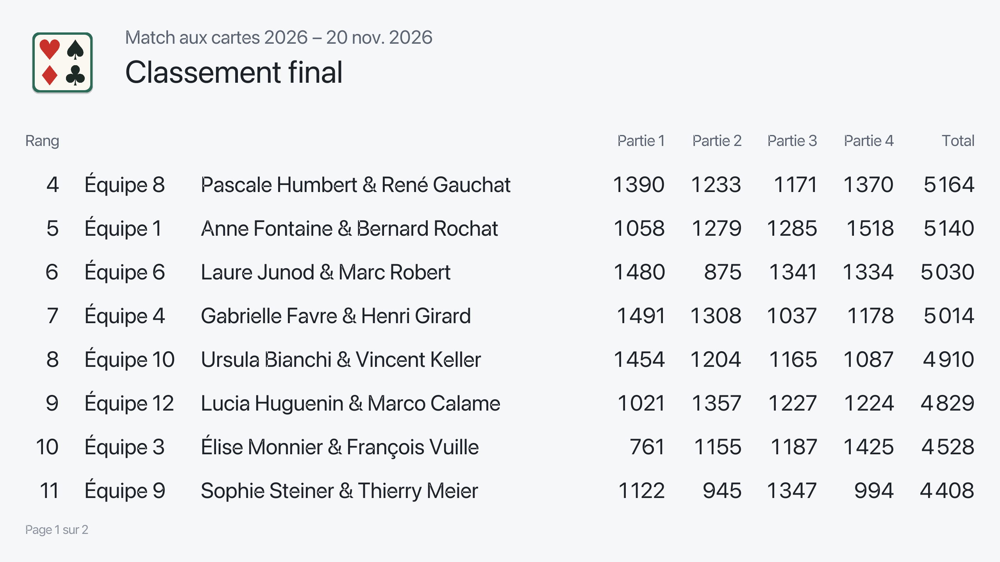

## 9. Saisir les points

La partie **Points** liste les parties avec leurs équipes et leur résultat. Choisissez une partie (ou **Feuille
suivante à saisir**) : sa feuille apparaît à droite, comme la feuille papier.

- La **colonne A** est l’équipe qui donne en premier (place impaire). Tapez ses points, donne par donne, et appuyez
  sur Entrée pour passer à la suivante (flèches haut et bas pour se déplacer).
- La **colonne B** est complétée automatiquement (157 − A, en gris) ; tapez-la seulement si la feuille indique
  autre chose.
- Chaque valeur est enregistrée aussitôt. Les sous-totaux par bloc de 4 donnes, les totaux, la **Déduction (règle
  16)** et les **points retenus** sont calculés.
- Une donne dont les deux colonnes ne font pas 157 points est surlignée, et la partie est marquée _Feuille à
  vérifier_ dans la liste.
- **Absent (règle 19)** : l’équipe adverse reçoit 1 256 points.
- **Effacer la feuille** recommence la saisie d’une partie.

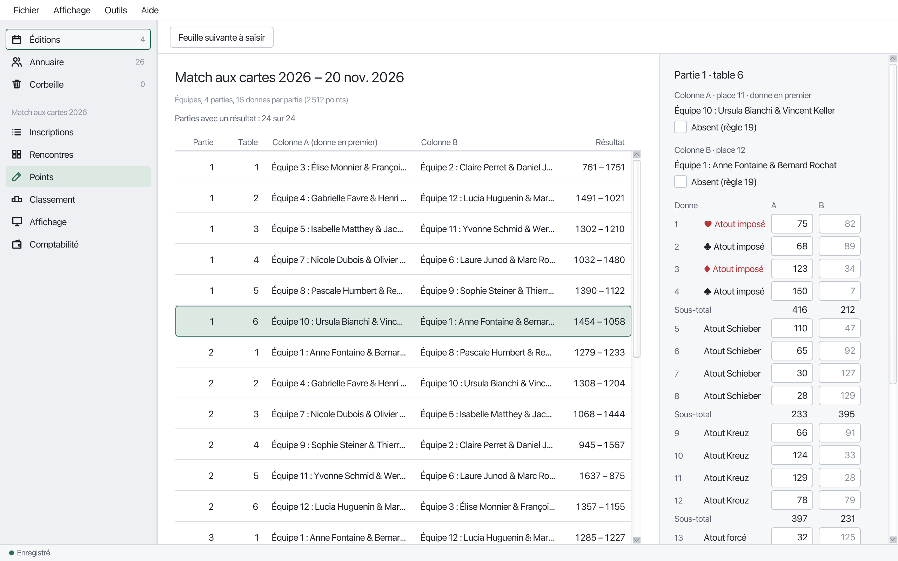

## 10. Établir le classement

Le **Classement** est recalculé à chaque affichage : provisoire tant que des parties n’ont pas de résultat, puis
définitif. Il donne le rang, les points de chaque partie et le total.

- **Égalités** (règle 15) : une fois toutes les parties saisies, **Tirer au sort les égalités**. Le tirage clôt le
  match : les feuilles ne sont plus modifiables. Pour corriger un score après coup, **Annuler le tirage**, corrigez,
  puis tirez au sort à nouveau.
- **Exclure pour tricherie** (règle 17) : toutes les parties du participant sont perdues, ses adversaires reçoivent
  1 256 points et il est retiré du classement. **Annuler l’exclusion** le réintègre.

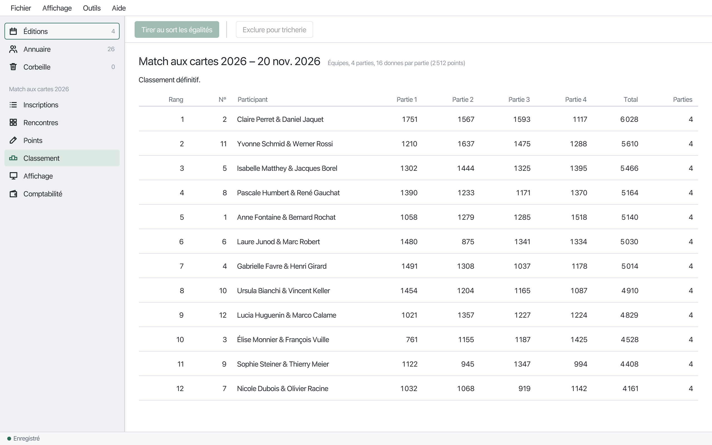

## 11. Tenir la comptabilité

La partie **Comptabilité** réunit les comptes de l’édition :

- **Finance par joueur (CHF)** et une case par joueur pour noter qui a payé ;
- **Nouvelle écriture** : date, recette ou dépense, catégorie (les catégories déjà utilisées sont proposées),
  description et montant (`1'234.50` ou `1234,50`), puis **Ajouter l’écriture** ;
- **Pièces justificatives** d’une écriture enregistrée : **Ajouter une pièce…** ou glissez des fichiers PDF, PNG ou
  JPEG (20 Mo au plus chacun). Elles sont gardées dans l’édition ; **Ouvrir** les montre avec l’application du
  système ;
- le **Bilan** : finances payées et à encaisser, recettes et dépenses par catégorie, solde (en rouge s’il est
  négatif).

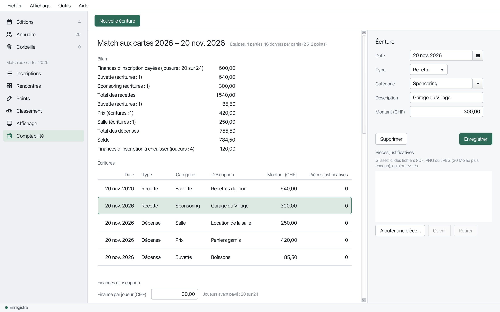

## 12. Sauvegarder, exporter, retrouver une édition

Les éditions et l’annuaire sont gardés dans le dossier de l’application ; aucun chemin n’est à choisir.

| Système | Dossier |
|---------|---------|
| macOS | `~/Library/Application Support/Jass Tournament` |
| Windows | `%APPDATA%\Jass Tournament` |
| Linux | `~/.local/share/jass-tournament` |

- **Fichier › Exporter l’édition…** crée un fichier `.jass` complet (pièces justificatives comprises), à transmettre
  à un autre organisateur, qui l’ouvre par **Importer une édition…**.
- **Fichier › Tout sauvegarder…** crée une archive ZIP de tout le dossier : à faire avant et après le tournoi, sur une
  clé USB par exemple.
- **Mettre l’édition à la corbeille** la déplace dans la **Corbeille**, d’où on peut la **Restaurer** ; **Vider la
  corbeille** la supprime définitivement.

## 13. Raccourcis clavier

« Cmd » sur macOS, « Ctrl » sur Windows et Linux.

| Raccourci | Action |
|-----------|--------|
| Cmd/Ctrl+N | Nouvel élément de la vue (édition, inscription, personne, écriture) |
| Cmd/Ctrl+S | Enregistrer le formulaire (inscription, personne, écriture) |
| Cmd/Ctrl+O | Importer |
| Cmd/Ctrl+E | Exporter |
| Cmd/Ctrl+F | Rechercher |
| Cmd/Ctrl+1, 2, 3 | Éditions, Annuaire, Corbeille |
| Cmd/Ctrl+B | Afficher ou masquer la barre latérale |
| Cmd/Ctrl+, | Réglages ou Options |
| Entrée | Ouvrir l’élément sélectionné ; passer à la donne suivante |
| Supprimer | Supprimer l’élément sélectionné (après confirmation) |
| F6, Maj+F6 | Passer d’un panneau à l’autre |

## 14. Messages fréquents

| Message | Que faire |
|---------|-----------|
| Il n’y a pas assez d’équipes (ou de joueurs) pour le nombre de parties. | Inscrivez davantage de participants ou réduisez le nombre de parties. |
| Le nombre de parties doit être pair. | Choisissez un nombre pair de parties. |
| Aucune partie de rattrapage n’est possible. | En mode individuel, inscrivez un joueur de plus ou de moins. |
| Aucun tableau n’a été trouvé à temps. | Relancez le calcul. |
| Rouvrez les inscriptions avant de changer les participants ou les parties. | Les rencontres sont calculées : **Rouvrir les inscriptions**. |
| Le tirage au sort a clos le match. | **Annuler le tirage** dans le classement pour corriger une feuille. |
| La mise à jour n’a pas pu être téléchargée. | Vérifiez la connexion à Internet : la mise à jour est proposée à nouveau au prochain démarrage. |

## 15. Données personnelles

L’application fonctionne sans Internet et n’envoie aucune donnée. À chaque démarrage, elle demande seulement à GitHub
si une version plus récente est publiée : GitHub voit l’adresse de la connexion (adresse IP), comme pour toute visite
d’une page web. Les adresses e-mail et numéros de téléphone ne sont gardés que dans l’annuaire de cet ordinateur :
jamais dans les fichiers d’édition, jamais sur les documents imprimés. Une personne peut demander ses données
(**Exporter l’annuaire…**), leur effacement (**Effacer les coordonnées**, **Supprimer la personne**) ou à ne plus être
contactée (statut _Ne pas contacter_).
