
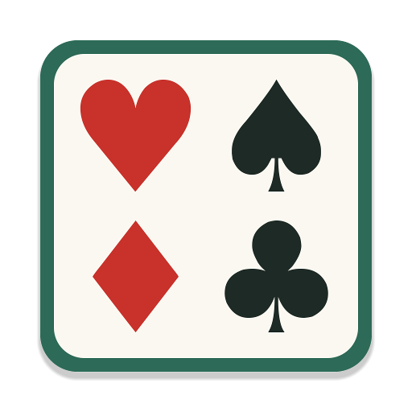

# Torneo di Jass — Guida all’uso

[English](en.md) · [Français](fr.md) · [Deutsch](de.md) · Italiano

Il **Torneo di Jass** gestisce un torneo di _Chibre_ dall’inizio alla fine: iscrizioni, tabellone degli incontri (chi
gioca contro chi in ogni partita, e quale squadra distribuisce per prima), documenti da stampare, inserimento dei
punti, classifica, schermo in sala e contabilità. Segue il regolamento del _match aux cartes des vétérans du FC
Bevaix_ e funziona senza connessione Internet.

Questa guida segue lo svolgimento di un torneo: preparare, iscrivere, stampare, giocare, classificare, chiudere i
conti.
Le schermate mostrano un torneo fittizio, con la presentazione di Windows e di Linux; su macOS, i menu sono nella barra dei menu del sistema.

## Sommario

1. [Installare l’applicazione](#1-installare-lapplicazione)
2. [Conoscere la finestra](#2-conoscere-la-finestra)
3. [Scegliere il logo dei documenti](#3-scegliere-il-logo-dei-documenti)
4. [Tenere l’elenco](#4-tenere-lelenco)
5. [Creare un’edizione](#5-creare-unedizione)
6. [Iscrivere i partecipanti](#6-iscrivere-i-partecipanti)
7. [Calcolare gli incontri e stampare i documenti](#7-calcolare-gli-incontri-e-stampare-i-documenti)
8. [Il giorno del torneo: lo schermo in sala](#8-il-giorno-del-torneo-lo-schermo-in-sala)
9. [Inserire i punti](#9-inserire-i-punti)
10. [Stabilire la classifica](#10-stabilire-la-classifica)
11. [Tenere la contabilità](#11-tenere-la-contabilità)
12. [Salvare, esportare, ritrovare un’edizione](#12-salvare-esportare-ritrovare-unedizione)
13. [Scorciatoie da tastiera](#13-scorciatoie-da-tastiera)
14. [Messaggi frequenti](#14-messaggi-frequenti)
15. [Dati personali](#15-dati-personali)

## 1. Installare l’applicazione

Scaricate il programma d’installazione del vostro sistema dalla pagina delle
[versioni pubblicate](https://github.com/porchy13/jass-tournament/releases):

| Sistema | File | Installazione |
|---------|------|---------------|
| macOS (Apple Silicon o Intel) | `.dmg` | Aprite il file, poi trascinate **Jass Tournament** nella cartella Applicazioni. |
| Windows | `.msi` | Aprite il file e seguite i passi. |
| Linux (Debian, Ubuntu) | `.deb` | `sudo apt install ./<file>.deb` |

L’applicazione non è ancora firmata:

- **macOS** rifiuta di aprirla la prima volta. Fate clic destro sull’applicazione, poi **Apri**; nelle versioni
  recenti di macOS, aprite **Impostazioni di Sistema › Privacy e sicurezza** e scegliete **Apri comunque**.
- **Windows** mostra un avviso di SmartScreen: scegliete **Ulteriori informazioni**, poi **Esegui comunque**.

L’applicazione parla la lingua del sistema: francese, tedesco, italiano, o inglese per ogni altra lingua.

### Aggiornare l’applicazione

A ogni avvio, l’applicazione verifica se è pubblicata una versione più recente. In tal caso la propone con le sue
novità: **Scarica e installa** scarica il programma d’installazione (l’avanzamento è mostrato, **Annulla** lo
interrompe), poi l’applicazione salva tutto, apre il programma d’installazione e si chiude; seguite i passi
dell’installazione come sopra. **Più tardi** rinvia l’aggiornamento al prossimo avvio. Senza Internet, l’applicazione
si avvia normalmente e non mostra nulla.

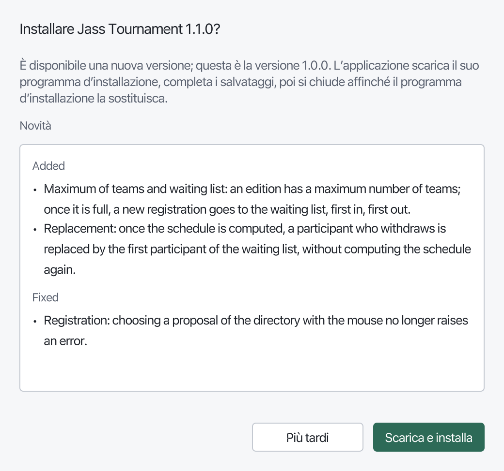

## 2. Conoscere la finestra

- **I menu** (in alto; su macOS, nella barra dei menu del sistema): **File**, **Vista**, **Strumenti** (tranne su
  macOS) e **Aiuto**.
- **La navigazione laterale** (a sinistra): **Edizioni**, **Elenco** e **Cestino**. Quando un’edizione è aperta,
  appare il suo nome con le sue parti: **Iscrizioni**, **Incontri**, **Punti**, **Classifica**, **Schermo** e
  **Contabilità**. Si usano in quest’ordine nel corso del torneo.
- **L’elenco** (al centro): il contenuto della parte scelta.
- **Il pannello di dettaglio** (a destra): l’elemento selezionato nell’elenco, pronto per essere modificato. In una
  finestra stretta, galleggia sopra l’elenco.
- **La barra di stato** (in basso): indica se tutto è **Salvato**, che cosa è selezionato, e gli avvisi.

**Non c’è niente da salvare a mano**: ogni modifica è salvata subito. Le azioni che eliminano qualcosa chiedono sempre
una conferma.

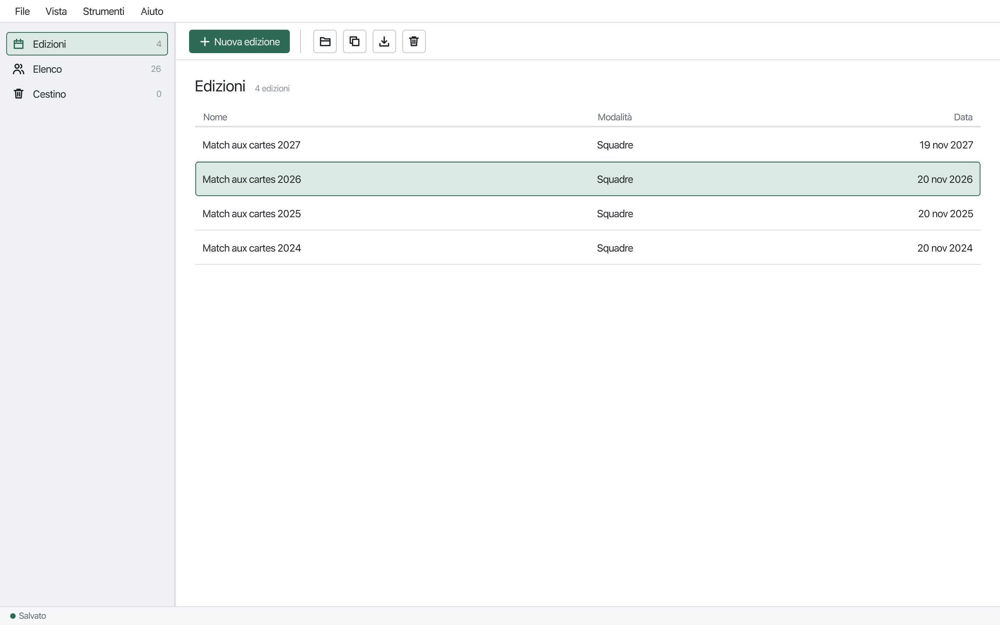

**Aiuto › Informazioni** mostra la versione dell’applicazione, il suo autore, la sua licenza e il link al suo codice
sorgente; **Fai una donazione** apre la pagina delle donazioni nel browser.

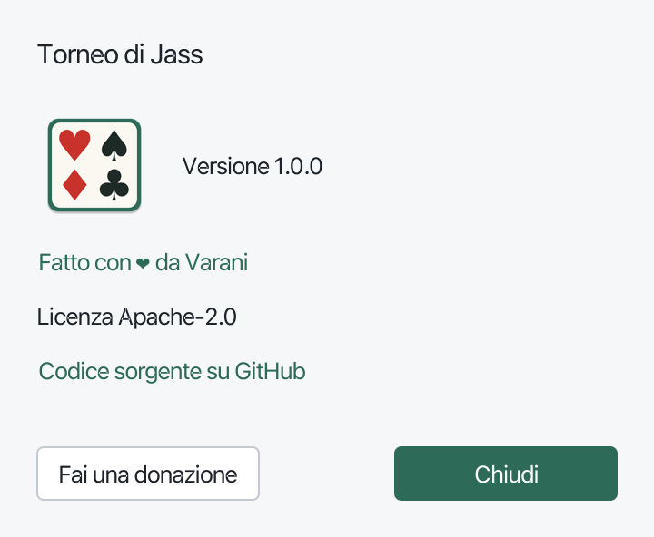

## 3. Scegliere il logo dei documenti

Il logo della vostra società o del vostro torneo è stampato **in alto a sinistra di ogni documento** (tabellone degli
incontri, posti da affiggere, schede dei punti, fogli dei risultati) e mostrato sullo **schermo in sala**. Sceglietelo
prima di stampare i documenti:

1. Aprite **Impostazioni…** (menu **File** su macOS) oppure **Opzioni…** (menu **Strumenti** su Windows e Linux).
2. Sotto **Logo dei documenti**, scegliete **Scegli un’immagine…** e selezionate l’immagine.
3. Il logo è mostrato nel pannello; la barra di stato conferma che figurerà sui documenti.

L’immagine deve essere un file **PNG o JPEG di al massimo 2 MB**. Un’immagine PNG **con sfondo trasparente** è la
più adatta, perché si fonde in tutti i documenti; un’immagine abbastanza grande resta nitida in stampa.

Il logo è lo stesso per **tutte le edizioni**: è conservato nella cartella dei dati dell’applicazione, non nelle
edizioni. Un’edizione esportata verso un altro computer non lo porta con sé: sceglietelo anche su quel computer.
**Salva tutto…** lo include nel salvataggio.

**Rimuovi il logo** (dopo una conferma) stampa i documenti senza logo.

Le stesse impostazioni regolano anche l’aspetto dell’applicazione: **Tema** (come il sistema, chiaro o scuro), **Usa
il colore d’accento del sistema** e **Riduci le animazioni**.

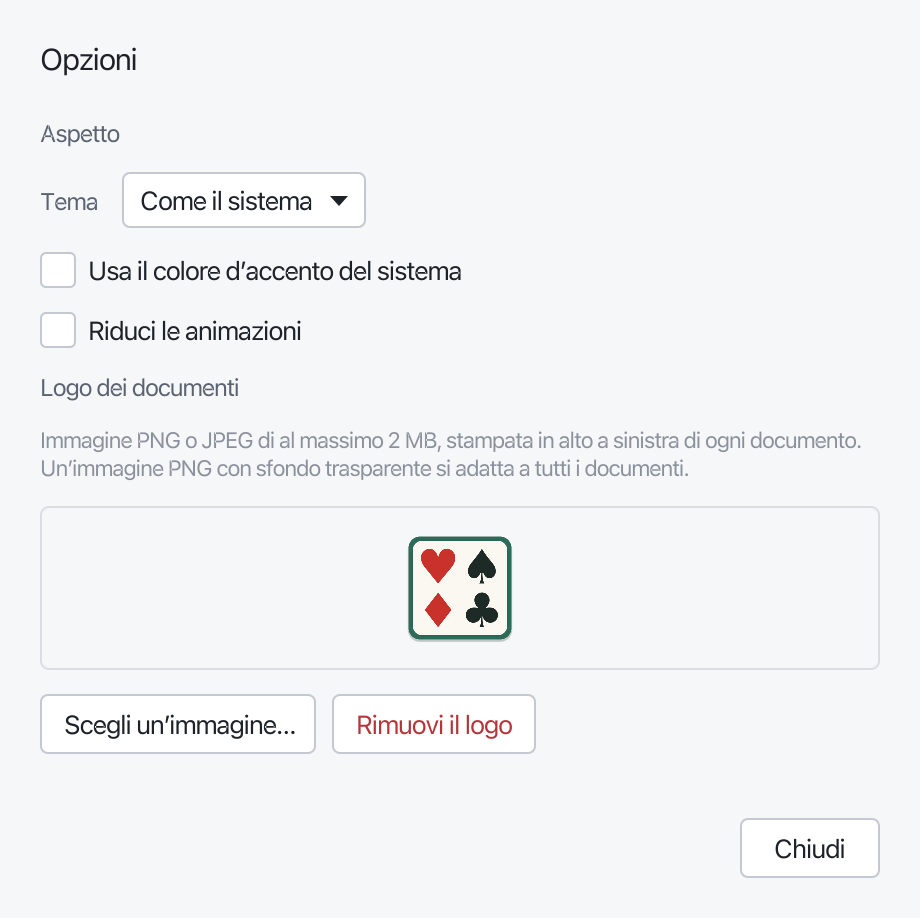

## 4. Tenere l’elenco

L’**Elenco** conserva le persone da un’edizione all’altra: sono proposte all’iscrizione e possono essere ricontattate
per il torneo successivo.

- **Nuova persona** (pulsante principale): nome (obbligatorio), cognome, e-mail, telefono, osservazioni, stato, poi
  **Salva**. Si possono inserire più persone di seguito, solo con la tastiera. Se esiste già una persona simile,
  l’applicazione lo segnala prima di creare un doppione.
- **Cercare** un nome; filtrare le persone di un’edizione.
- **Stato**: _Contattabile_, _Non contattare_ (su richiesta della persona) o _Deceduto_. Gli ultimi due escludono la
  persona dagli elenchi di contatti; una persona deceduta non è più proposta all’iscrizione.
- **Copia gli indirizzi e-mail** o **Copia i numeri di telefono** delle persone selezionate, per incollarli in un
  messaggio (le persone da non contattare sono escluse).
- **Unisci le due persone selezionate** riunisce due schede della stessa persona.
- **Cancella i recapiti** o **Elimina la persona** li cancella definitivamente.
- **Importa persone…** da un file CSV o da righe copiate da un foglio di calcolo: scegliete le colonne, controllate
  l’anteprima (valori non validi e possibili doppioni segnalati), poi **Importa**. I doppioni sono importati solo se
  è selezionato **Importare anche i possibili doppioni**.
- **Esporta l’elenco…** in CSV, per esempio per rispondere a una persona che chiede i dati conservati su di lei.

L’elenco parte vuoto; si può anche riempire man mano con le iscrizioni.

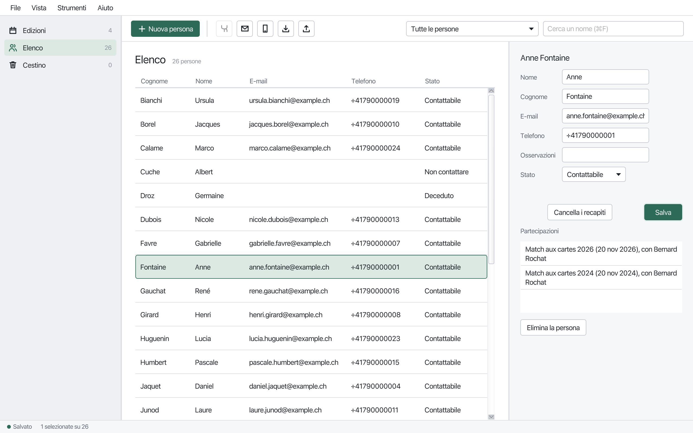

## 5. Creare un’edizione

In **Edizioni**, scegliete **Nuova edizione**:

- **Nome** e **Data**;
- **Modalità**: _Squadre_ (le squadre di due giocatori si iscrivono insieme) o _Individuale_ (ogni giocatore si
  iscrive da solo; l’applicazione forma le squadre cambiando compagno a ogni partita e limitando quante volte due
  giocatori si incontrano come avversari);
- **Partite per partecipante**: 4 secondo il regolamento; il numero deve essere pari, perché ogni squadra distribuisce
  per prima in metà delle sue partite;
- **Contenuto delle partite**: il tipo di ogni mano (briscola imposta ♥ ♣ ♦ ♠, _Schieber_, _Kreuz_, briscola
  obbligata). **Piano del regolamento** ripristina le 16 mani del regolamento; **Aggiungi 4 mani** e **Togli 4 mani**
  ne cambiano il numero, sempre un multiplo di 4.

**Crea** resta disattivato finché manca un valore; il motivo è indicato.

Per l’anno successivo, selezionate l’edizione precedente e scegliete **Duplica l’edizione**: la nuova riprende la
modalità, le partite, il contenuto delle partite e la quota d’iscrizione, ma non le iscrizioni.

Aprite un’edizione con un doppio clic o con il tasto Invio.

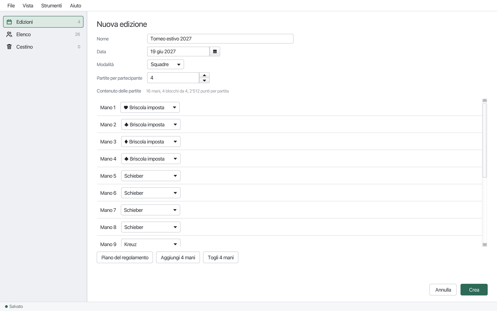

## 6. Iscrivere i partecipanti

In **Iscrizioni**, il pannello a destra accoglie i giocatori (due per squadra, uno solo in modalità individuale):

1. Digitate il nome o il cognome: sono proposte fino a 8 persone dell’elenco, tranne quelle già iscritte
   all’edizione; sceglietene una, oppure continuate a
   digitare per una persona nuova, che sarà aggiunta all’elenco.
2. Se il giocatore ha già giocato, l’applicazione propone di **riprendere la squadra precedente** con il compagno di
   allora.
3. **Iscrivere** (Cmd+S su macOS, Ctrl+S altrove) aggiunge l’iscrizione; **Nuova iscrizione** svuota il pannello.

Selezionate un’iscrizione per **Correggerla** o **Toglierla**. Se nel frattempo i nomi di un giocatore sono stati
corretti nell’elenco, l’iscrizione è segnata _Nomi corretti nell’elenco_: **Correggi** riprende i nuovi nomi.

Una persona segnata come deceduta nell’elenco non può essere iscritta. Se digitate il suo nome e cognome,
l’applicazione chiede se si tratta di un’altra persona con lo stesso nome: **Altra persona** la aggiunge all’elenco e
la iscrive, altrimenti non viene iscritto nulla. Un’iscrizione il cui giocatore è stato segnato come deceduto nel
frattempo è segnata _Persona deceduta nell’elenco_: per correggerla, sostituite questa persona (può sempre essere
tolta).

È indicato il numero di iscritti, con il minimo necessario per calcolare gli incontri (per esempio 5 squadre per
4 partite).

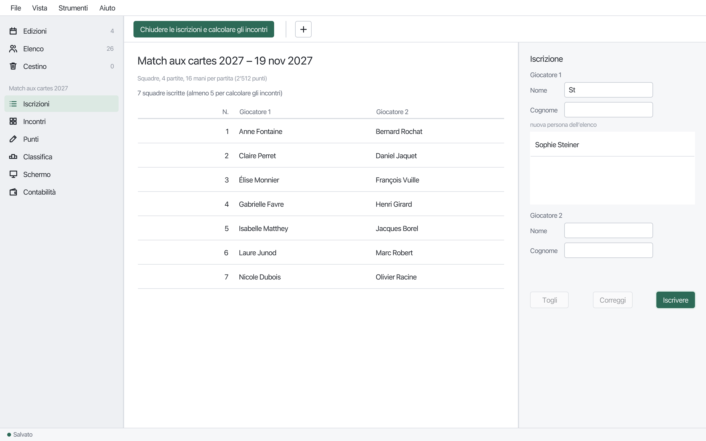

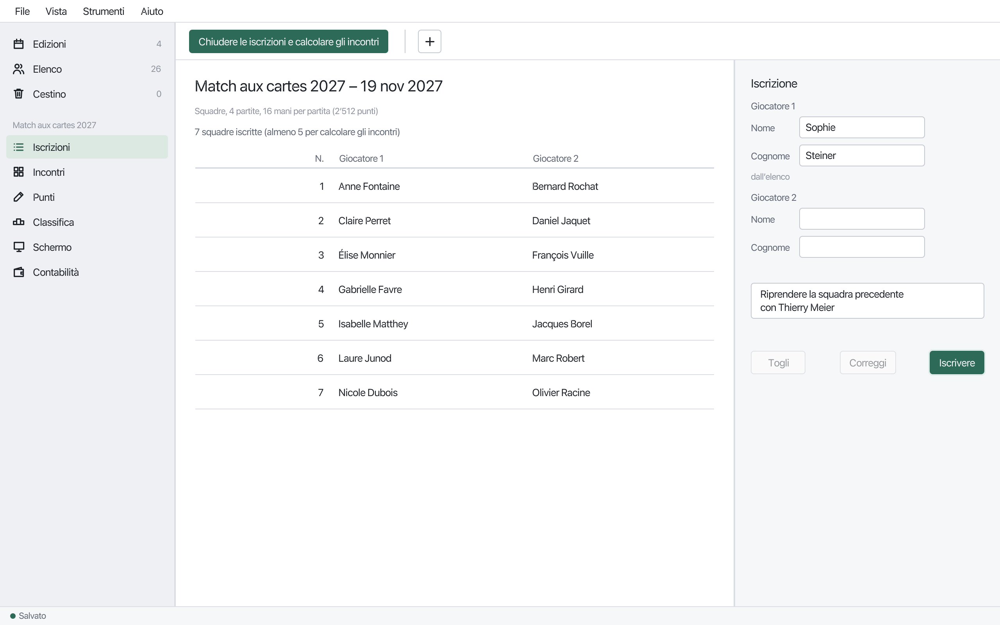

## 7. Calcolare gli incontri e stampare i documenti

Quando tutti sono iscritti, scegliete **Chiudere le iscrizioni e calcolare gli incontri**. Il calcolo dura al massimo
un minuto; una barra ne mostra l’avanzamento, e **Interrompi il calcolo** lo ferma.

Il tabellone rispetta il regolamento: ogni squadra gioca il numero di partite previsto, non incontra mai due volte la
stessa squadra e distribuisce per prima in metà delle sue partite. A ogni tavolo, la squadra con il posto più piccolo
distribuisce per prima. Con un numero dispari di squadre, una squadra è a riposo in ciascuna delle prime partite, e le
squadre che sono state a riposo giocano tra loro una partita di recupero.

La parte **Incontri** mostra ogni partita con i suoi tavoli, i suoi posti, la squadra che distribuisce per prima e
quella che riceve, e i partecipanti a riposo. Esporta in PDF i documenti seguenti; ognuno porta il
[logo scelto](#3-scegliere-il-logo-dei-documenti), il suo titolo e il nome dell’edizione:

| Documento | Uso |
|-----------|-----|
| **Tabellone degli incontri** | Il tabellone completo, partita per partita. |
| **Posti da affiggere** | Una riga per partecipante con il suo posto in ogni partita (un trattino quando è a riposo): da affiggere all’entrata della sala. |
| **Schede dei punti** | Una scheda per partecipante, quattro per pagina A4 da ritagliare: il suo posto in ogni partita e le caselle dove annota i punti e il totale. |
| **Fogli dei risultati** | Un foglio per partita e per tavolo, due per pagina A4 orizzontale da ritagliare: le due squadre con il loro posto, poi le mani del contenuto delle partite, da compilare durante il gioco. |

Un’iscrizione tardiva o un ritiro? **Riaprire le iscrizioni** (finché nessun punto è inserito) elimina gli incontri,
che sono ricalcolati alla chiusura successiva. Ristampate poi i documenti.

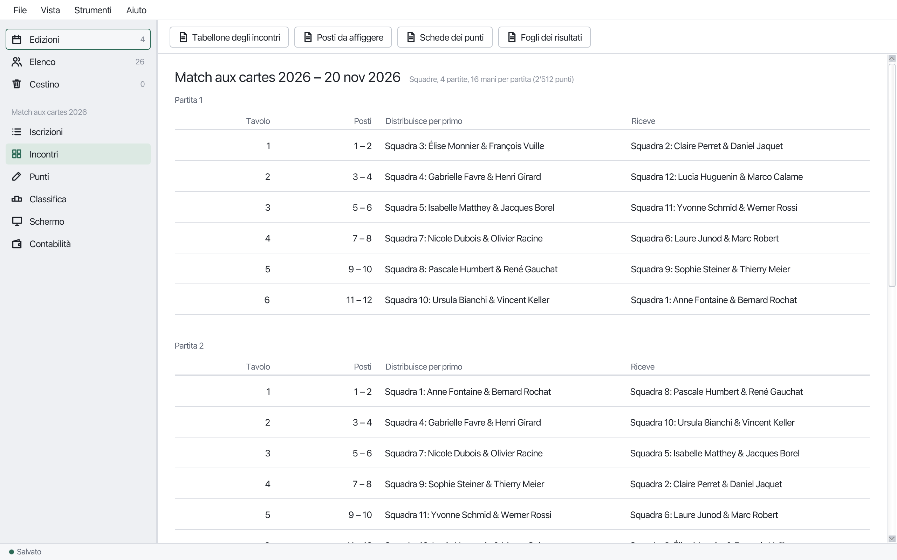

<table>
<tr><td align="center" valign="top">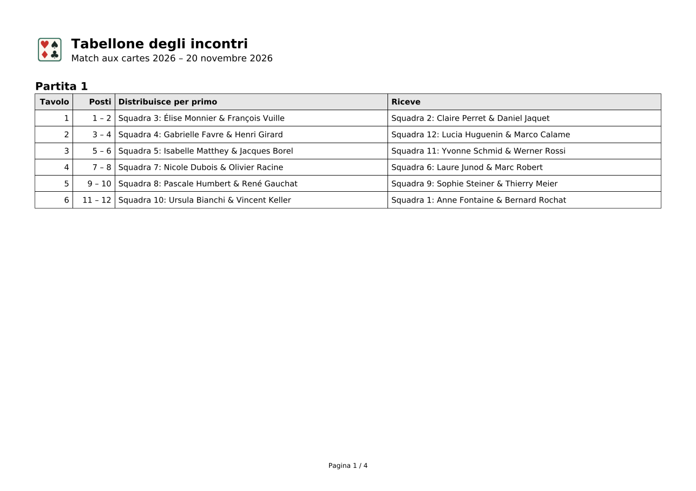 Tabellone degli incontri</td><td align="center" valign="top">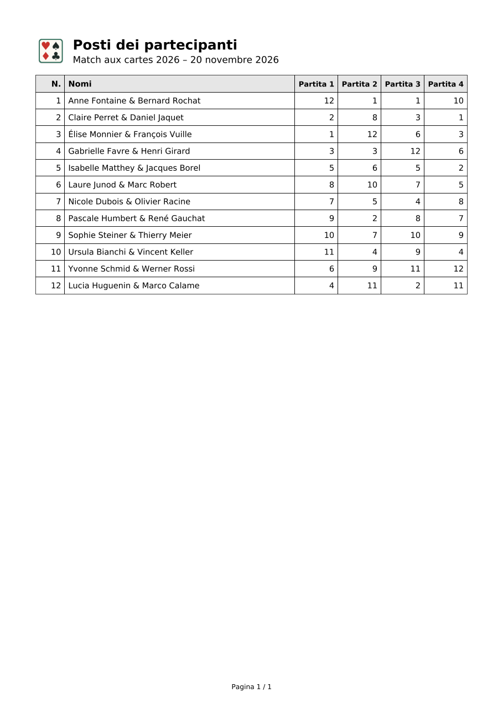 Posti da affiggere</td></tr>
<tr><td align="center" valign="top">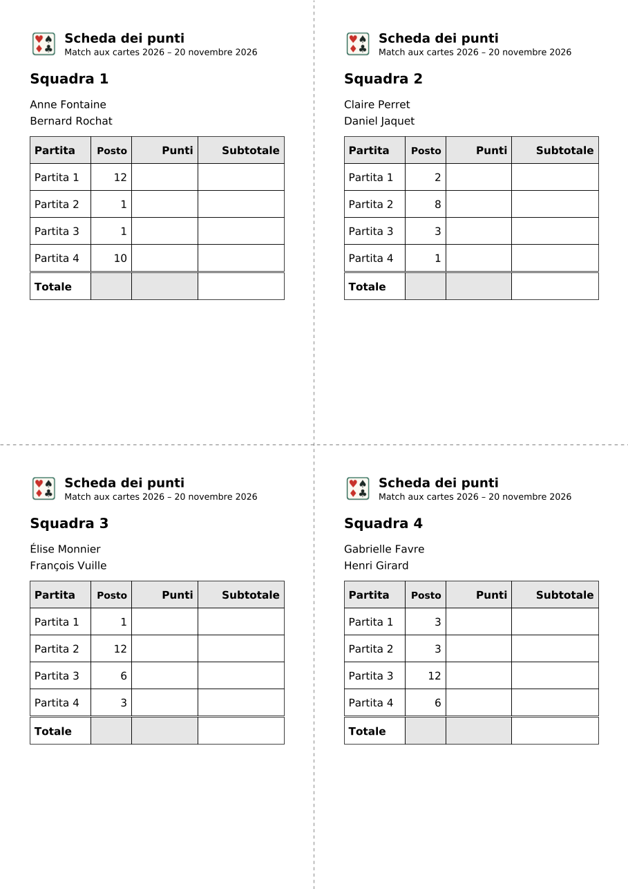 Schede dei punti</td><td align="center" valign="top">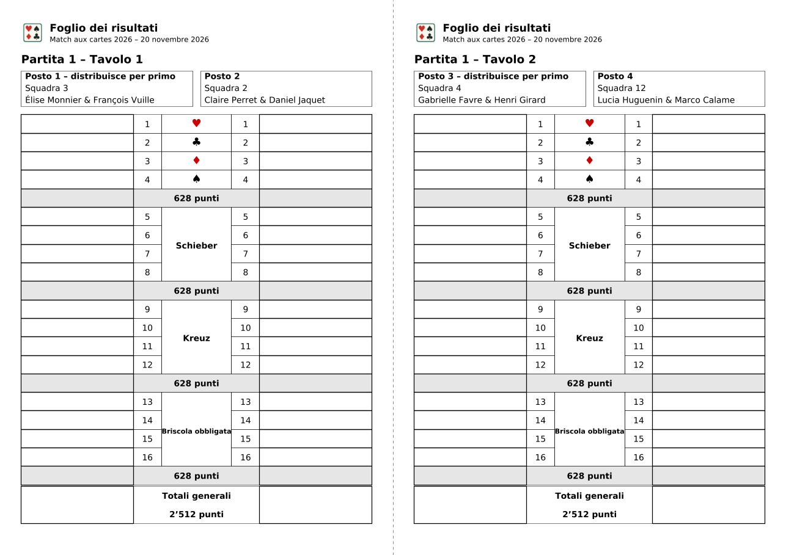 Fogli dei risultati</td></tr>
</table>

## 8. Il giorno del torneo: lo schermo in sala

La parte **Schermo** comanda una seconda finestra, da portare su un proiettore o un televisore:

1. **Apri lo schermo**, scegliete il **Monitor**, poi **Schermo intero**.
2. Regolate la **Durata di una partita (minuti)** (60 di base, conservata con l’edizione).
3. All’inizio di ogni partita, **Dai il via**: lo schermo mostra il tempo restante, poi «Tempo scaduto». **Annulla il
   via** in caso di errore.

Lo schermo mostra il logo dei documenti, l’edizione, la partita in corso e il posto e il tavolo di ogni partecipante;
gli elenchi troppo lunghi si alternano per pagine ogni 10 secondi, e una barra accanto al numero della pagina si
svuota fino alla pagina successiva. La partita mostrata è quella in corso; **Mostra la
partita** ne sceglie un’altra.

Alla fine del torneo, **Mostra la classifica**, poi **Rivela il rango** uno per uno, dall’ultimo al primo. Durante la
rivelazione, lo schermo resta sulla prima pagina: il rango rivelato per ultimo è sempre in alto e, se manca lo spazio,
i ranghi in basso spariscono dallo schermo. Una volta rivelato tutto, lo stesso pulsante diventa **Far scorrere le
pagine**: cliccatelo quando volete perché le pagine della classifica completa si alternino ogni 10 secondi.
**Nascondi tutto** ricomincia la rivelazione, sulla prima pagina.

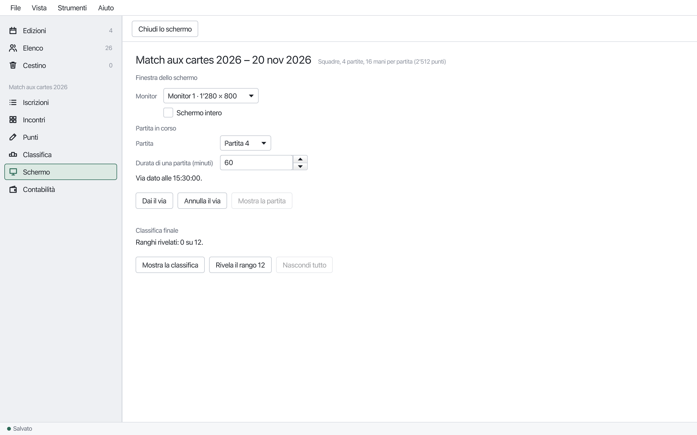

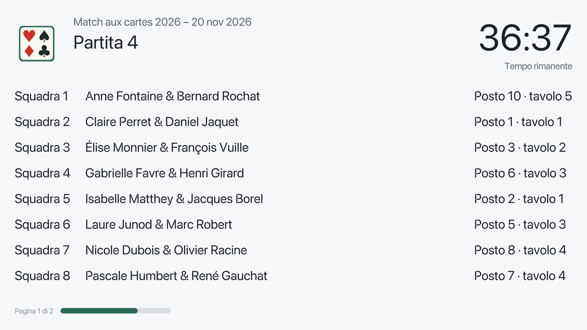

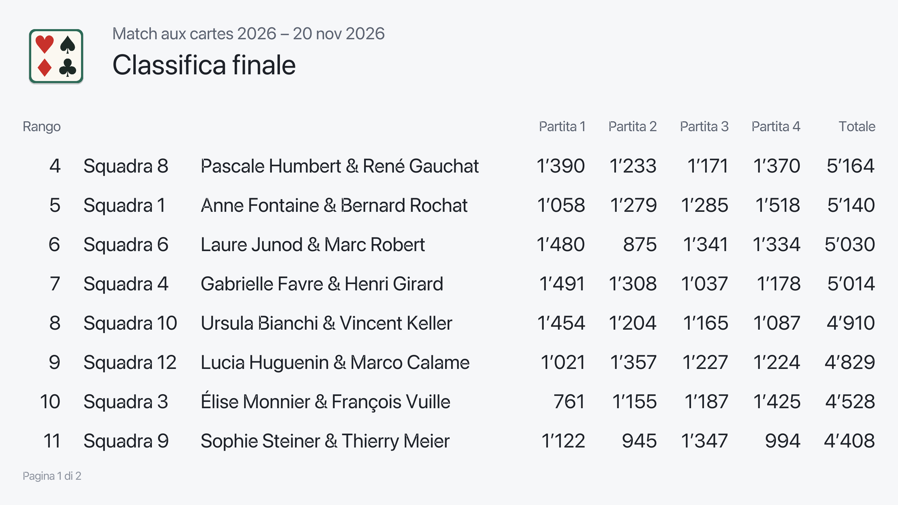

## 9. Inserire i punti

La parte **Punti** elenca le partite con le loro squadre e il loro risultato. Scegliete una partita (o **Foglio
successivo da inserire**): il suo foglio appare a destra, come il foglio di carta.

- La **colonna A** è la squadra che distribuisce per prima (posto dispari). Digitate i suoi punti, mano per mano, e
  premete Invio per passare alla successiva (frecce su e giù per spostarsi).
- La **colonna B** è completata automaticamente (157 − A, in grigio); digitatela solo se il foglio indica altro.
- Ogni valore è salvato subito. I subtotali per blocco di 4 mani, i totali, la **Deduzione (regola 16)** e i **punti
  conteggiati** sono calcolati.
- Una mano le cui due colonne non fanno 157 punti è evidenziata, e la partita è segnata _Foglio da verificare_
  nell’elenco.
- **Assente (regola 19)**: la squadra avversaria riceve 1’256 punti.
- **Cancella il foglio** ricomincia l’inserimento di una partita.

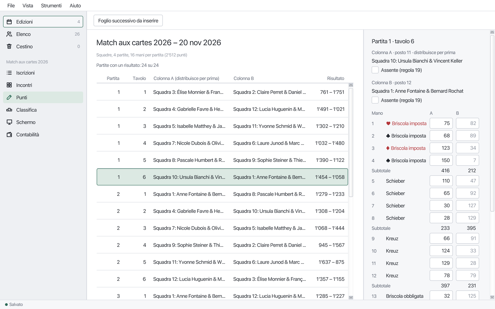

## 10. Stabilire la classifica

La **Classifica** è ricalcolata a ogni visualizzazione: provvisoria finché alcune partite non hanno un risultato, poi
definitiva. Indica il rango, i punti di ogni partita e il totale.

- **Parità** (regola 15): quando tutte le partite hanno un risultato, **Sorteggia le parità**. Il sorteggio chiude il
  match: i fogli non sono più modificabili. Per correggere un punteggio in seguito, **Annulla il sorteggio**,
  correggete, poi sorteggiate di nuovo.
- **Escludi per imbroglio** (regola 17): tutte le partite del partecipante sono perse, i suoi avversari ricevono
  1’256 punti ed è tolto dalla classifica. **Annulla l’esclusione** lo reintegra.

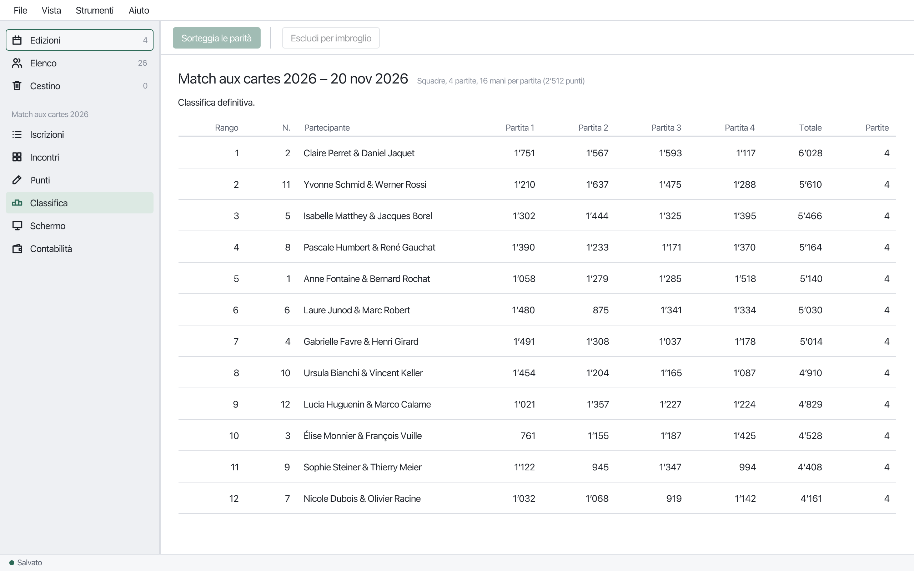

## 11. Tenere la contabilità

La parte **Contabilità** riunisce i conti dell’edizione:

- **Quota per giocatore (CHF)** e una casella per giocatore per annotare chi ha pagato;
- **Nuova registrazione**: data, entrata o uscita, categoria (sono proposte le categorie già usate), descrizione e
  importo (`1'234.50` o `1234,50`), poi **Aggiungi la registrazione**;
- **Giustificativi** di una registrazione salvata: **Aggiungi un giustificativo…** o trascinate file PDF, PNG o JPEG
  (al massimo 20 MB ciascuno). Sono conservati nell’edizione; **Apri** li mostra con l’applicazione del sistema;
- il **Bilancio**: quote pagate e da incassare, entrate e uscite per categoria, saldo (in rosso se negativo).

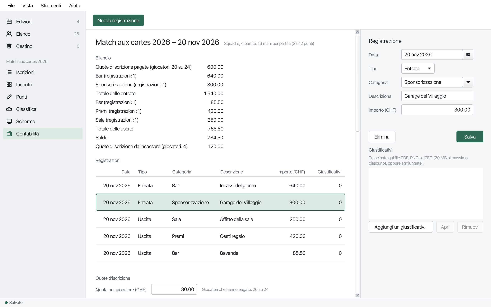

## 12. Salvare, esportare, ritrovare un’edizione

Le edizioni e l’elenco sono conservati nella cartella dei dati dell’applicazione; non c’è nessun percorso da
scegliere.

| Sistema | Cartella |
|---------|----------|
| macOS | `~/Library/Application Support/Jass Tournament` |
| Windows | `%APPDATA%\Jass Tournament` |
| Linux | `~/.local/share/jass-tournament` |

- **File › Esporta l’edizione…** crea un file `.jass` completo (giustificativi compresi), da trasmettere a un altro
  organizzatore, che lo apre con **Importa un’edizione…**.
- **File › Salva tutto…** crea un archivio ZIP di tutta la cartella: da fare prima e dopo il torneo, per esempio su
  una chiavetta USB.
- **Sposta l’edizione nel cestino** la porta nel **Cestino**, da cui si può recuperare con **Ripristina**; **Svuota il
  cestino** la elimina definitivamente.

## 13. Scorciatoie da tastiera

«Cmd» su macOS, «Ctrl» su Windows e Linux.

| Scorciatoia | Azione |
|-------------|--------|
| Cmd/Ctrl+N | Nuovo elemento della vista (edizione, iscrizione, persona, registrazione) |
| Cmd/Ctrl+S | Salvare il modulo (iscrizione, persona, registrazione) |
| Cmd/Ctrl+O | Importare |
| Cmd/Ctrl+E | Esportare |
| Cmd/Ctrl+F | Cercare |
| Cmd/Ctrl+1, 2, 3 | Edizioni, Elenco, Cestino |
| Cmd/Ctrl+B | Mostrare o nascondere la barra laterale |
| Cmd/Ctrl+, | Impostazioni o Opzioni |
| Invio | Aprire l’elemento selezionato; passare alla mano successiva |
| Canc | Eliminare l’elemento selezionato (dopo una conferma) |
| F6, Maiusc+F6 | Passare da un pannello all’altro |

## 14. Messaggi frequenti

| Messaggio | Che cosa fare |
|-----------|---------------|
| Non ci sono abbastanza squadre (o giocatori) per il numero di partite. | Iscrivete più partecipanti o riducete il numero di partite. |
| Il numero di partite deve essere pari. | Scegliete un numero pari di partite. |
| Con questo numero di giocatori non è possibile una partita di recupero. | In modalità individuale, iscrivete un giocatore in più o in meno. |
| Nessun tabellone è stato trovato in tempo. | Rilanciate il calcolo. |
| Riaprite le iscrizioni prima di cambiare i partecipanti o le partite. | Gli incontri sono calcolati: **Riaprire le iscrizioni**. |
| Il sorteggio ha chiuso il match. | **Annulla il sorteggio** nella classifica per correggere un foglio. |
| Non è stato possibile scaricare l’aggiornamento. | Verificate la connessione a Internet: l’aggiornamento è proposto di nuovo al prossimo avvio. |

## 15. Dati personali

L’applicazione funziona senza Internet e non invia alcun dato. A ogni avvio chiede soltanto a GitHub se è pubblicata
una versione più recente: GitHub vede l’indirizzo della connessione (indirizzo IP), come per ogni visita di una pagina
web. Gli indirizzi e-mail e i numeri di telefono sono conservati solo nell’elenco di questo computer: mai nei file
delle edizioni, mai sui documenti stampati. Una persona può chiedere i suoi dati (**Esporta l’elenco…**), la loro
cancellazione (**Cancella i recapiti**, **Elimina la persona**) o di non essere più contattata (stato _Non
contattare_).
